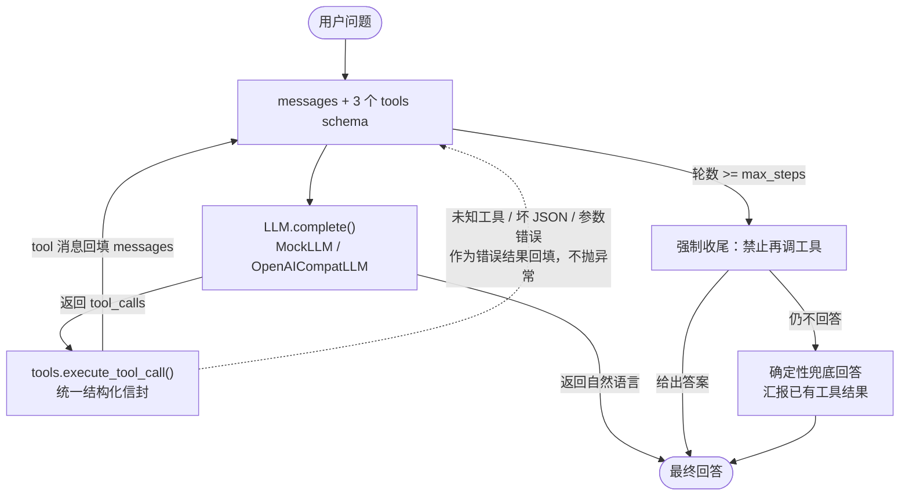
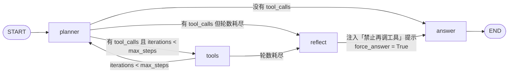

# 劳动法咨询 Agent（function calling + LangGraph）

> **一句话定位**：一个能调用 3 个工具（法条检索 / 赔偿精算 / 引用核验）的劳动法咨询 Agent demo，用**原生 function calling**和 **LangGraph StateGraph** 两种方式实现同一套能力；离线 Mock 模式可完整复现工具调用链路，真实模型只需换一个 `BaseLLM` 实现。

**关键词**：AI 应用 · Agent · Function Calling · LangGraph · 工具调用 · 劳动法 · 可观测 trace

| 实测环境 | 值 |
|---|---|
| Python | 3.11.9（Windows 11 / CPU，无 GPU） |
| 法条语料 | 357 条真实法条（劳动合同法 98 / 劳动法 107 / 劳动争议调解仲裁法 54 / 社会保险法 98） |
| 依赖版本 | rank-bm25 0.2.2、langgraph 1.2.24、openai 3.57.0、pytest 9.2.0 |
| 测试 | `pytest tests -q` → **106 passed in 2.90s**（2026-11-21，单次实测，耗时随机器波动） |
| 真实模型 | 本环境**没有** `OPENAI_API_KEY`，真实模型链路**未端到端实测**（代码 + 响应解析单测已覆盖，见下文如实说明） |

> 这是一个作品集 demo，不是法律产品。所有法条来自共享语料，金额按法条机械计算，**不构成法律意见**。

---

## 目录

- [1. 为什么做这个 demo](#1-为什么做这个-demo)
- [2. 架构](#2-架构)
- [3. 快速开始](#3-快速开始)
- [4. 工具清单](#4-工具清单)
- [5. 实测结果](#5-实测结果)
- [6. 两种实现对比](#6-两种实现对比)
- [7. 面试怎么讲](#7-面试怎么讲)
- [8. 局限与下一步](#8-局限与下一步)
- [9. 数据、依赖与免责声明](#9-数据依赖与免责声明)

---

## 1. 为什么做这个 demo

求职作品集里已经有一个「基于 RAG 的法律咨询系统」作为知识侧项目。这个项目补的是**行动侧**：

- LLM 不只回答问题，还要**决定调用哪个工具**、**把工具结果组织成答案**、**在工具失败时继续走**；
- 金额、法条这类「错一个数字就露馅」的信息**必须由确定性代码产出**，不能靠 LLM 心算或记忆；
- 两种实现（手写循环 vs LangGraph）能讲清楚「Agent 框架到底帮你做了什么」。

与 RAG 项目的关系：**不依赖它的代码或索引**，只读取仓库共享且只读的 `shared/corpus/labor_law_articles.jsonl`。两个项目在叙事上互补：RAG 做知识，Agent 做行动。

---

## 2. 架构

### 2.1 方案 A：原生 function calling 循环

`labor_agent/function_calling.py`：一个 `while` + 一个 `if` 就构成 Agent 主循环，不依赖任何 Agent 框架。



关键点：

- **Mock 与真模型走完全相同的循环**：`MockLLM` 也返回 `tool_calls`，所以没有 API key 也能演示「模型决策 → 工具执行 → 结果回填 → 再决策」的完整链路；
- 工具失败不会中断循环：`execute_tool_call` 永远返回结构化结果，错误作为 tool 消息交还给模型；
- 三层止损：`max_steps` 轮数上限 → 强制收尾提示 → 确定性兜底回答。

### 2.2 方案 B：LangGraph StateGraph

`labor_agent/langgraph_agent.py`：把同一套控制流显式建模成「节点 + 条件边」。



- `planner`：调用 LLM，拿到 tool_calls 或自然语言草稿；
- `tools`：复用与方案 A **同一份** `state.execute_pending_calls()`；
- `reflect`：预算耗尽时的显式反思/止损节点，注入「禁止再调工具」系统提示；
- `answer`：收尾，写入最终回答；
- 条件边负责路由，`max_steps` 控制轮数上限，`recursion_limit` 兜底。

真实图结构由命令 `python -m labor_agent.cli graph` 从编译后的图导出（实测输出见 [5.4](#54-langgraph-图结构真实输出)）。

### 2.3 两个方案的共享层

```
tools.py  ── 3 个工具 + JSON Schema + execute_tool_call（两种方案共用）
state.py  ── AgentState / trace / 工具执行 / 强制收尾 / 兜底（两种方案共用）
llm.py    ── BaseLLM 抽象：MockLLM ↔ OpenAICompatLLM（两种方案共用）
```

`tests/test_langgraph_agent.py::test_langgraph_and_function_calling_agree_on_amounts` 直接断言：同一个问题两种实现算出的金额与计算步骤完全一致（324000.00 元）。对比两种实现时，差异只剩**控制流**，不是两套重复代码。

---

## 3. 快速开始

> 只需要仓库里的 `.venv-rag` 解释器，**不需要 pip install、不需要 API key、不联网**。所有命令都在项目根目录 `.` 下执行（Windows PowerShell）。

### 3.1 运行 demo（Mock 模式，默认）

```powershell
cd "."
$py = "python"

# 5 个内置问题，打印完整 trace（思考 / 工具调用 / 参数 / 返回 / 最终答案）
& $py -m labor_agent.cli demo

# 想截图时关掉 ANSI 颜色，得到纯文本
& $py -m labor_agent.cli demo --no-color
```

### 3.2 问单个问题

```powershell
# 默认 Mock + 方案 A（function calling）
& $py -m labor_agent.cli ask "公司违法辞退我，月薪12000，工作3年7个月，能赔多少？依据哪一条？" --no-color

# 方案 B（LangGraph），输出结构与方案 A 完全一致
& $py -m labor_agent.cli ask "公司违法辞退我，月薪12000，工作3年7个月，能赔多少？" --framework langgraph

# 机器可读：完整 JSON（含 messages / tool_results / trace）
& $py -m labor_agent.cli ask "入职5个月没签书面劳动合同，月薪15000，二倍工资差额多少？" --json

# 输出 LangGraph 图的 mermaid 定义
& $py -m labor_agent.cli graph
```

`--framework` 可选 `auto`（默认，`ask` 走方案 A）、`function_calling`、`langgraph`；`--max-steps` 控制模型决策轮数（默认 function_calling=6，langgraph=4）；`--mock` / `--openai` 二选一，**默认永远是 mock**，不会误用真实 API 产生费用。

### 3.3 真实模型模式（可选）

先设置环境变量，再显式加 `--openai`：

```powershell
$env:OPENAI_API_KEY  = "sk-..."                  # 必需
$env:OPENAI_BASE_URL = "https://api.deepseek.com/v1"   # 可选：任何 OpenAI 兼容端点
$env:OPENAI_MODEL    = "deepseek-chat"           # 可选：默认 gpt-4o-mini

& $py -m labor_agent.cli demo --openai
& $py -m labor_agent.cli ask "公司违法辞退我，月薪12000，工作3年7个月，能赔多少？" --openai
```

- 走标准 OpenAI `tools` / `tool_calls` 协议，可直接接 DeepSeek、vLLM、Ollama 等兼容端点；
- 缺少 `OPENAI_API_KEY` 时会给出可操作的中文报错，不会静默回退；
- **如实说明**：本作品集环境没有 API key，上面两条 `--openai` 命令**未做真实网络端到端验证**；已验证的是「无 key 时的友好报错」以及「OpenAI 响应 → `LLMResponse` 解析」的单元测试（使用假 client，不联网）。

### 3.4 跑测试

```powershell
& $py -m pytest tests -q
```

### 3.5 目录结构

```
02-labor-law-agent/
├── labor_agent/
│   ├── __init__.py          # 包导出（懒加载 langgraph，未安装也不影响 import）
│   ├── __main__.py          # python -m labor_agent
│   ├── corpus.py            # 357 条法条加载 + 中文 BM25（rank_bm25 / 标准库兜底）
│   ├── tools.py             # 3 个工具 + OpenAI JSON Schema + 统一调用入口
│   ├── llm.py               # BaseLLM / MockLLM / OpenAICompatLLM
│   ├── state.py             # 共用状态 + trace + 工具执行 + 强制收尾 / 兜底
│   ├── function_calling.py  # 方案 A：原生 function calling 循环
│   ├── langgraph_agent.py   # 方案 B：StateGraph（延迟导入 langgraph）
│   └── cli.py               # ask / demo / graph 子命令 + trace 渲染
├── tests/
│   ├── test_corpus.py           # 语料、条号规范化、检索
│   ├── test_tools.py            # 3 个工具的金额/边界/错误处理
│   ├── test_llm.py              # Mock 确定性、真实模型响应解析
│   ├── test_function_calling.py # 方案 A 循环 + 未知工具/坏 JSON/轮数上限
│   ├── test_langgraph_agent.py  # 方案 B + reflect 分支 + 两方案一致性
│   └── test_cli.py              # CLI 端到端 + python -m 入口
├── requirements.txt
├── README.md
└── .gitignore
```

---

## 4. 工具清单

3 个工具都是：**普通 Python 函数（可独立测试）+ OpenAI function calling JSON Schema + 统一结构化返回**。Schema 见 `labor_agent/tools.py` 的 `TOOL_SCHEMAS`。

| 工具 | 入参（JSON Schema 关键字段） | 返回 | 为什么需要它 |
|---|---|---|---|
| `search_labor_law` | `query`（必填，自然语言/关键词）、`top_k`（1-20，默认 5）、`law_id`（可选 `lcl`/`ll`/`lda`/`sil`） | `count` + `results[]`：`rank`、`score`（BM25）、`law`、`article_no`、`title`、`snippet`（正文片段）；未命中给 `hint` | 答案要引真实法条，LLM 记忆里的条号/内容不可信；检索结果可直接展示给用户 |
| `calc_severance` | `payload`：`scenario`（`severance` / `unlawful_termination` / `double_wage` / `overtime`）、`monthly_salary`、`years`、`months`、`months_without_contract`、`overtime_hours{workday,rest_day,holiday}`、`city_avg_salary` | `total`、`total_yuan`、`steps[]`（每步公式+金额）、`legal_basis[]`（真实法条原文）、`notes`、`warnings`、`summary` | 金额必须可复现、可审计；LLM 心算 21.75 天、3 倍封顶、11 个月上限几乎必错 |
| `verify_citation` | `law_id`、`article_no`（支持 `47`/`"第47条"`/`"第四十七条"`）、`claim` | `status`（`verified` / `partial` / `not_found`）+ 逐项 `checks`（数字/关键词是否命中）+ `reasons` + 法条原文 | 「条号存在」≠「引用正确」：防止条号对了但内容张冠李戴；回答前先自检 |

### 4.1 统一返回信封

```jsonc
// 成功
{"ok": true, "tool": "calc_severance", "data": {...}, "error": null}
// 失败（不会抛异常给 Agent 主循环）
{"ok": false, "tool": "search_labor_law", "data": null,
 "error": {"code": "invalid_arguments_json", "message": "工具参数不是合法 JSON：..."}}
```

错误码：`unknown_tool`（模型编造工具名）、`invalid_arguments_json`（坏 JSON）、`invalid_arguments`（字段/类型/业务规则不合法，带 `field`）、`internal_error`。两种 Agent 实现都依赖这一个入口做错误隔离——测试里专门覆盖了「模型调用不存在的工具」和「参数是坏 JSON」两种情况。

### 4.2 计算规则与依据（第 47 / 87 / 82 条、劳动法第 44 条）

| scenario | 规则 | 实测用例（`tests/test_tools.py`） |
|---|---|---|
| `severance` | N = 每满一年 1 个月；6 个月以上不满 1 年按 1 年；不满 6 个月按半个月。月薪 > 社平 3 倍：基数按 3 倍、年限最高 12 年 | 12000 元 / 3 年 7 个月 → N=4 → **48000.00 元**；30000 元 / 15 年 / 社平 9000 → **324000.00 元** |
| `unlawful_termination` | 2N（第 87 条，基数为第 47 条标准） | 12000 元 / 3 年 7 个月 → **96000.00 元** |
| `double_wage` | 未签书面合同，额外一倍月工资，最长 11 个月 | 15000 元 / 14 个月 → 按 11 个月计 → **165000.00 元** |
| `overtime` | 小时工资 = 月薪 ÷ 21.75 ÷ 8；工作日 1.5 倍、休息日 2 倍、法定节假日 3 倍 | 12000 元 + 10/8/4 小时 → 1034.48 + 1103.45 + 827.59 = **2965.52 元** |

工具返回的 `legal_basis` 不是手写的，而是从 357 条真实语料里查出来的原文；`steps` 保留每一步公式，面试时可以直接讲「为什么是这个数」。

---

## 5. 实测结果

> 以下全部是在本机 `.venv-rag` + Mock 模式下**真实运行**的输出（2026-11-21，`--no-color` 便于贴文档）。没有跑过的指标会明确写「未测量」。

### 5.1 `demo` 汇总（5 个内置问题，真实运行）

命令：`python -m labor_agent.cli demo --no-color`

```text
==========================================================================
Demo 汇总（真实运行结果）
#  框架              工具调用                          轮数 金额/结论
1  function_calling  calc_severance, search_labor_law  2    96000.00 元
2  function_calling  calc_severance                    2    324000.00 元
3  function_calling  calc_severance                    2    165000.00 元
4  function_calling  calc_severance                    2    2965.52 元
5  langgraph         verify_citation                   2    引用核验: partial
==========================================================================
提示：以上为 MOCK 离线模拟输出，用于演示工具调用链路，不是真实大模型回答。
```

`demo --framework langgraph` 也逐题验证过（5/5 跑通，金额与方案 A 相同）。

### 5.2 一次完整 trace（真实输出）

命令：`python -m labor_agent.cli ask "公司违法辞退我，月薪12000，工作3年7个月，能赔多少？依据哪一条？" --no-color`

```text
──────────────────────────────────────────────────────────────────────────
❓ 问题：公司违法辞退我，月薪12000，工作3年7个月，能赔多少？依据哪一条？
🧭 框架：function_calling｜模式：MOCK 离线模拟（规则引擎，非真实大模型）｜模型轮数：2｜工具调用：2 次
──────────────────────────────────────────────────────────────────────────
[1] 🚀 开始 function calling 循环
    LLM：LLM=mock-rules｜MOCK（离线规则模拟，非真实大模型）
    框架：function_calling｜最大轮数：6
[2] 🧠 第 1 轮模型决策
    思考：（MOCK 规则引擎）识别为「违法解除赔偿金 2N」场景，调用 calc_severance 精算；问题还要求法律依据，同时调用 sear…
    → 工具调用 calc_severance({"scenario": "unlawful_termination", "monthly_salary": 12000.0, "years": 3, "months": 7})
    → 工具调用 search_labor_law({"query": "违法解除劳动合同 赔偿金 经济补偿 第四十七条 第八十七条", "top_k": 3})
[3] 🛠 工具返回：calc_severance
    参数：{"scenario": "unlawful_termination", "monthly_salary": 12000.0, "years": 3, "months": 7}
    ✓ 经济补偿金 N = 48000.00 元；违法解除赔偿金 2N = 96000.00 元
    1. 工作年限折算：3 年 7 个月 → 满 3 年 + 余 7 个月（六个月以上不满一年按一年）→ N = 4
    2. 月工资基数：月工资 = 12000.00 元；未提供社平工资，未触发封顶
    3. 经济补偿金 N：N × 月工资基数 = 4 × 12000.00
    4. 违法解除赔偿金 2N：2 × 经济补偿金 = 2 × 48000.00
[4] 🛠 工具返回：search_labor_law
    参数：{"query": "违法解除劳动合同 赔偿金 经济补偿 第四十七条 第八十七条", "top_k": 3}
    ✓ 命中 3 条法条
    · 《劳动合同法》第八十七条 BM25=93.6142
      用人单位违反本法规定解除或者终止劳动合同的，应当依照本法第四十七条规定的经济补偿标准的…
    · 《劳动法》第二十八条 BM25=70.5449
      用人单位依据本法第二十四条、第二十六条、第二十七条的规定解除劳动合同的，应当依照国家有…
    · 《劳动合同法》第四十八条 BM25=62.7155
      …续履行的，用人单位应当依照本法第八十七条规定支付赔偿金。
[5] 🧠 第 2 轮模型决策
    模型输出：【MOCK 离线模拟输出】以下内容由离线规则引擎根据工具返回结果拼装，**不是真实大模型的推理输出**，仅用于演示工具…
[6] ✅ 最终回答（1053 字，forced=False）
──────────────────────────────────────────────────────────────────────────
💬 最终回答
【MOCK 离线模拟输出】以下内容由离线规则引擎根据工具返回结果拼装，**不是真实大模型的推理输出**，仅用于演示工具调用链路。

## 违法解除赔偿金 2N
- 结论：经济补偿金 N = 48000.00 元；违法解除赔偿金 2N = 96000.00 元
- 精确金额：96000.00 元（约 96000 元）

计算过程：
1. 工作年限折算：3 年 7 个月 → 满 3 年 + 余 7 个月（六个月以上不满一年按一年）→ N = 4
2. 月工资基数：月工资 = 12000.00 元；未提供社平工资，未触发封顶
3. 经济补偿金 N：N × 月工资基数 = 4 × 12000.00
4. 违法解除赔偿金 2N：2 × 经济补偿金 = 2 × 48000.00

法律依据（来自真实语料）：
- 《劳动合同法》第四十七条：经济补偿按劳动者在本单位工作的年限，每满一年支付一个月工资的标准向劳动者支付。六个月以上不满一年的，按一年计算；不满六个月的，向劳动者支付半个月工资的经济补偿。劳动者月工资高于用人单位所在直辖市、设区的市级人民政府公布的本地区上年度职工月…
- 《劳动合同法》第八十七条：用人单位违反本法规定解除或者终止劳动合同的，应当依照本法第四十七条规定的经济补偿标准的二倍向劳动者支付赔偿金。…

注意：
- 未提供 city_avg_salary（当地上年度职工月平均工资），未应用《劳动合同法》第 47 条的「社平工资 3 倍封顶、年限最高 12 年」；若你在一二线城市，实际金额可能更低。
- 依据《劳动合同法》第 87 条，用人单位违法解除应按第 47 条经济补偿标准的 2 倍支付赔偿金；若劳动者要求继续履行合同，则可能不适用 2N（第 48 条）。
## 法条检索（命中 3 条）
- **《劳动合同法》第八十七条**（BM25 93.6142）：用人单位违反本法规定解除或者终止劳动合同的，应当依照本法第四十七条规定的经济补偿标准的二倍向劳动者支付赔偿金。
- **《劳动法》第二十八条**（BM25 70.5449）：用人单位依据本法第二十四条、第二十六条、第二十七条的规定解除劳动合同的，应当依照国家有关规定给予经济补偿。
- **《劳动合同法》第四十八条**（BM25 62.7155）：…续履行的，用人单位应当依照本法第八十七条规定支付赔偿金。

（以上为规则模板输出。真实上线版本会由 LLM 组织自然语言，但金额与法条仍应来自工具返回，避免模型编造。）
──────────────────────────────────────────────────────────────────────────
```

`[2]` 这一轮 MockLLM 一次返回 **2 个 tool_calls**，演示了「一轮多工具」；`[5]` 把工具结果回填后生成最终答案。真实模型下同样的循环只是把 `思考` 换成模型的自然语言。

### 5.3 `pytest` 结果（真实输出）

命令：`python -m pytest tests -q`

```text
........................................................................ [ 67%]
..................................                                       [100%]
106 passed in 2.90s
```

覆盖范围：3 个工具的金额精确值/边界/非法参数、未知工具、坏 JSON、轮数上限、模型异常、引用核验三种结论、LangGraph 图与 reflect 分支、CLI 端到端、`python -m labor_agent.cli` 子进程入口。

### 5.4 LangGraph 图结构（真实输出）

命令：`python -m labor_agent.cli graph`

```text
---
config:
  flowchart:
    curve: linear
---
graph TD;
	__start__([<p>__start__</p>]):::first
	planner(planner)
	tools(tools)
	reflect(reflect)
	answer(answer)
	__end__([<p>__end__</p>]):::last
	__start__ --> planner;
	planner -.-> answer;
	planner -.-> reflect;
	planner -.-> tools;
	reflect -.-> answer;
	tools -.-> planner;
	tools -.-> reflect;
	answer --> __end__;
	classDef default fill:#f2f0ff,line-height:1.2
	classDef first fill-opacity:0
	classDef last fill:#bfb6fc
```

（上面就是 `graph.get_graph().draw_mermaid()` 的输出，不是手画示意图。）

### 5.5 检索质量抽样（真实运行）

`corpus.search_articles` 的 top-1 断言已写进测试：

| 查询 | top-1 结果 |
|---|---|
| 违法解除劳动合同 赔偿金 | 《劳动合同法》第八十七条 |
| 未签书面劳动合同 二倍工资 | 《劳动合同法》第八十二条 |
| 经济补偿 工作年限 每满一年 | 《劳动合同法》第四十七条 |
| 加班 延长工作时间 休息日 法定休假日 | 《劳动法》第四十四条 |

**未测量**：检索的 Recall@k / MRR（没有标注 query-法条 对；357 条小语料上做这些指标意义有限，下一步会建评测集）。

---

## 6. 两种实现对比

两者共用 `tools.py` / `state.py` / `llm.py`，相同输入下金额与法条一致（有测试断言）。

| 维度 | 方案 A：原生 function calling | 方案 B：LangGraph StateGraph |
|---|---|---|
| **控制流** | `while` 循环 + `if tool_calls`，全部在一个函数里（`function_calling.py`） | 显式图：`planner → tools → reflect → answer`，条件边决定路由 |
| **代码量（实测行数）** | 控制流模块 **123 行** | 控制流模块 **272 行**（含节点函数、路由、回调、图构建） |
| **可观测性** | 手写 `add_trace`；trace 是线性事件流，简单直观 | 节点名天然进入 trace；`get_graph().draw_mermaid()` 直接导出架构图；接 checkpointer 可回放/断点续跑 |
| **重试 / 分支** | 手写：轮数上限 + 强制收尾 + 兜底；新增分支要改循环 | 加节点/加条件边即可；`reflect` 就是一个独立止损分支，未来可扩成「检索失败 → 重写 query → 再检索」 |
| **状态管理** | 普通 dict/TypedDict，进程内 | 同一个 `TypedDict` 作为图状态 channel，天然可持久化（LangGraph checkpointer） |
| **依赖 / 启动成本** | 只要 LLM SDK；改一行就能跑 | 额外依赖 langgraph；本仓库用延迟导入，未安装时自动提示回退方案 A |
| **调试体验** | 断点直接打在循环里，简单 | 图结构可可视化，但节点/边/状态更新需要理解框架语义 |
| **适用场景** | 单 Agent、工具少、快速上线、面试展示「Agent 原理」 | 多工具/多分支、需要人工介入（human-in-the-loop）、长时间任务、断点续跑 |

结论（面试可直接说）：**LangGraph 并没有让代码更短**（123 行 → 272 行），它买的是「控制流显式化 + 可视化 + 可持久化 + 易扩展分支」。这个 demo 里 2 个方案都能完成任务；如果只是 3 个工具的问答，手写循环更轻；一旦要加多轮追问、工具重试、人工审批，图编排的收益才会显现。

---

## 7. 面试怎么讲

### 7.1 讲解要点（8 条）

1. **拆成能力层与编排层**：`tools.py`（能力）+ `state.py`（执行/状态/兜底）被两套编排复用，证明我理解 Agent 的本质是「模型决策 + 工具执行 + 状态回填」，框架只是控制流的不同写法。
2. **金额不走 LLM**：经济补偿/2N/二倍工资/加班费全部由确定性代码计算，返回逐步公式；LLM 只负责选工具和组织语言。这解决了幻觉金额问题，也让结果可审计、可单测。
3. **MockLLM 是诚实的降级方案**：它是关键词规则引擎（不是假装成模型的随机输出），保证离线 demo、CI 和面试现场在无网无 key 时也能跑；所有输出都带 `MOCK` 标识。真实模型只是换 `BaseLLM.complete` 的实现。
4. **工具失败是数据不是异常**：未知工具名、坏 JSON、非法参数都转成结构化 tool 消息回填，模型可以看到错误继续走或向用户解释；测试覆盖了这三类错误。
5. **四层止损**：`max_steps` → 强制收尾「禁止再调工具」→ 仍失败则确定性兜底 → CLI 返回非 0 退出码。避免死循环和「模型硬编答案」。
6. **引用核验是防幻觉的第二道闸**：`verify_citation` 先查条号是否存在，再把 claim 里的数字/关键词与真实法条原文逐项比对；条号存在但内容对不上会返回 `not_found/partial`，而不是硬说 verified。
7. **中文检索的工程取舍**：不引入 jieba，用「单字 + 二元组」BM25；357 条小语料上 top-1 命中稳定，依赖少、可解释。下一步再上和 RAG 项目互补的向量检索 + rerank。
8. **可观测性为面试/调试服务**：trace 记录每轮模型决策、工具参数、工具返回、兜底原因；`--json` 可回放完整 messages。现场演示 10 秒能讲清一次 Agent 运行。

### 7.2 三个可能被追问的问题

**Q1：为什么不用现成 Agent 框架的 tool node，非要自己写 function calling？**

> 我先手写方案 A 是为了把原理吃透：所谓 tool node 本质就是「解析 tool_calls → 执行 → 把结果作为 tool 消息回填 → 再请求模型」，没有任何魔法。然后方案 B 用 LangGraph 把它图化，对比才知道框架帮我做了什么（状态管理、条件边、checkpoint、可视化）。选型上：3 个工具的单 Agent 手写更轻；要加多轮追问、工具重试、人工审批或多 Agent 协作时，LangGraph 的显式图更合适。两个方案共用同一套 tools/state，保证对比公平。

**Q2：工具失败怎么办？**

> 分三层。第一层，工具内部：所有参数错误、业务规则不满足都返回 `{ok:false, error:{code, field, message}}`，不抛异常；主循环把错误当作 tool 消息回填，模型可以选择换参数重试或告诉用户缺什么。第二层，主循环：`max_steps` 限制轮数，超限后强制收尾（禁止再调工具），仍不回答就用确定性兜底把已有结果汇报出来，不会空转。第三层，工程化：CLI 对模型/参数错误返回非 0 退出码；测试覆盖未知工具、坏 JSON、非法参数、模型异常、轮数耗尽。生产上还会补超时、重试退避、熔断和日志脱敏。

**Q3：Mock 和真模型到底差在哪？会不会演示的是假效果？**

> 差距很清楚：MockLLM 是确定性规则引擎，只会按关键词识别有限问法，不理解自然语言，也不会生成新表述；真模型能处理未覆盖的问法、多轮对话和追问。所以 README 里所有 demo 输出都明确标了 `MOCK`，金额/法条来自真实工具，trace 是真实运行。Mock 的价值是：无 key 环境下可复现地验证「工具选择 → 参数 → 执行 → 回填 → 回答」的链路，并让测试稳定（同样输入同样输出）。真模型切换只需要 `--openai` + `BaseLLM` 实现；本环境没有 key，所以真实模型端到端没有实测，我不会把 mock 的结果说成模型效果。

---

## 8. 局限与下一步

### 8.1 已知局限（如实说明）

- **MockLLM 覆盖面有限**：只识别关键词组合出的常见问法；换一种说法可能识别不到意图（会退化为法条检索或说明缺什么信息）。它不理解上下文，没有多轮记忆。
- **真实模型链路未端到端实测**：本机无 `OPENAI_API_KEY`，只验证了无 key 报错与 OpenAI 响应解析的单测。延迟/费用/真实工具选择准确率：**未测量**。
- **计算器覆盖有限**：未覆盖代通知金、未休年假折算、医疗补助、社保公积金、竞业限制违约金、工伤待遇等；社平工资/最低工资有地区差异，工具需要用户提供 `city_avg_salary`，否则明确提示「未应用封顶」。
- **引用核验是启发式**：只做「数字 + 关键词」比对，同义改写、否定语气、跨条引用（本条引用其他条）会误判；`partial` 的语义是「需人工复核」，不是法律结论。
- **检索是单路 BM25**：无语义向量、无 query rewrite/rerank/多路融合；对口语化长问题的召回一般。
- **Agent 能力边界**：无多轮对话状态、无工具并发、无超时/重试、无权限与审计；LangGraph 侧未接 checkpointer，不支持断点续跑。

### 8.2 下一步

1. **接 RAG 项目**：把 `search_labor_law` 换成 01 项目的向量检索 + BM25 混合检索，再加 rerank，对比 top-k 质量。
2. **建评测集**：30-50 条带标准答案（场景/金额/法条）的问答，测「工具选择准确率、金额正确率、引用核验准确率」——当前这些指标都是**未测量**，没有评测集之前不编数。
3. **引用核验升级**：规则比对 + LLM judge 双校验，覆盖同义表述和跨条引用；对 `partial` 给出更细的缺失项定位。
4. **多轮与状态**：给 LangGraph 接 `MemorySaver`/checkpointer，支持追问（「那如果月薪是 2 万呢？」复用上轮槽位），CLI 加交互模式。
5. **工具工程化**：超时/重试/并发、结构化日志、trace 导出 JSONL 做回归分析。
6. **真实模型验证**：配置 key 后跑同一批 demo，测量工具选择准确率和端到端延迟，再回来更新 README 的数字。

---

## 9. 数据、依赖与免责声明

### 数据

- 法条语料：仓库共享的 `shared/corpus/labor_law_articles.jsonl`，共 **357 条**真实法条（劳动合同法 98 / 劳动法 107 / 劳动争议调解仲裁法 54 / 社会保险法 98），来源与抓取脚本见 `shared/corpus/provenance.json` 与 `shared/corpus/parse_laws.py`。
- 语料为只读：本项目不修改、不复制、不重新生成法条数据。

### 依赖

见 `requirements.txt`。核心约束：

- 只使用仓库统一环境 `.venv-rag`，不新建 venv；
- `rank-bm25` 缺失时自动降级为包内纯标准库 BM25（公式对齐 BM25Okapi），`langgraph` 缺失时方案 B 延迟导入并给出回退提示——这两点都有代码保护，不会因为缺依赖导致整个项目不可用；
- `openai` 仅在 `--openai` 时延迟导入。

### 免责声明

本项目是 AI 应用求职作品集的演示项目，计算结果是按法条做的机械估算，未考虑个案的证据、时效、地区差异等因素，**不构成法律意见**。涉及真实劳动争议请咨询执业律师或当地劳动仲裁机构。

### 复现全部结果

```powershell
cd "."
$py = "python"
& $py -m labor_agent.cli demo --no-color          # 5 个问题 + trace
& $py -m labor_agent.cli ask "公司违法辞退我，月薪12000，工作3年7个月，能赔多少？依据哪一条？" --no-color
& $py -m labor_agent.cli graph                    # LangGraph mermaid
& $py -m pytest tests -q                          # 106 passed
```
