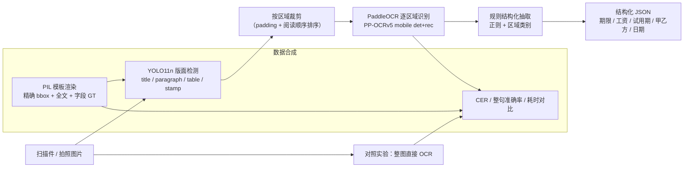
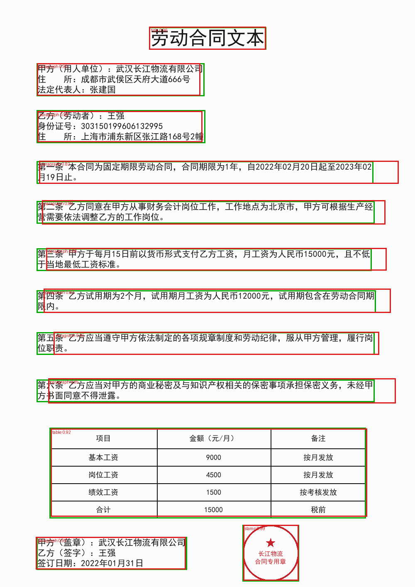
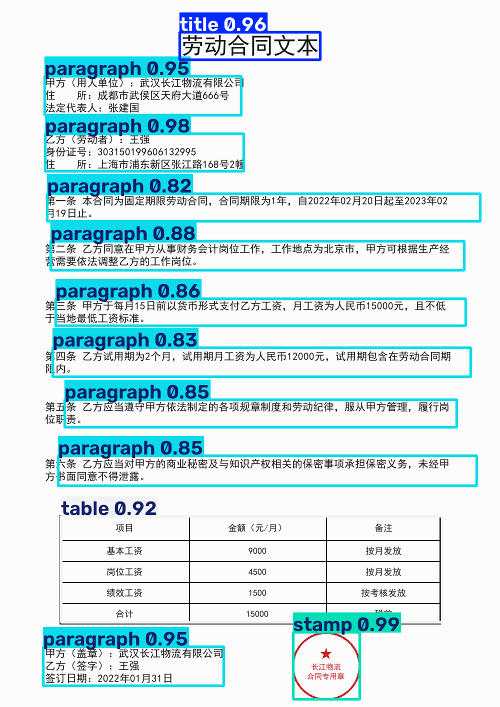
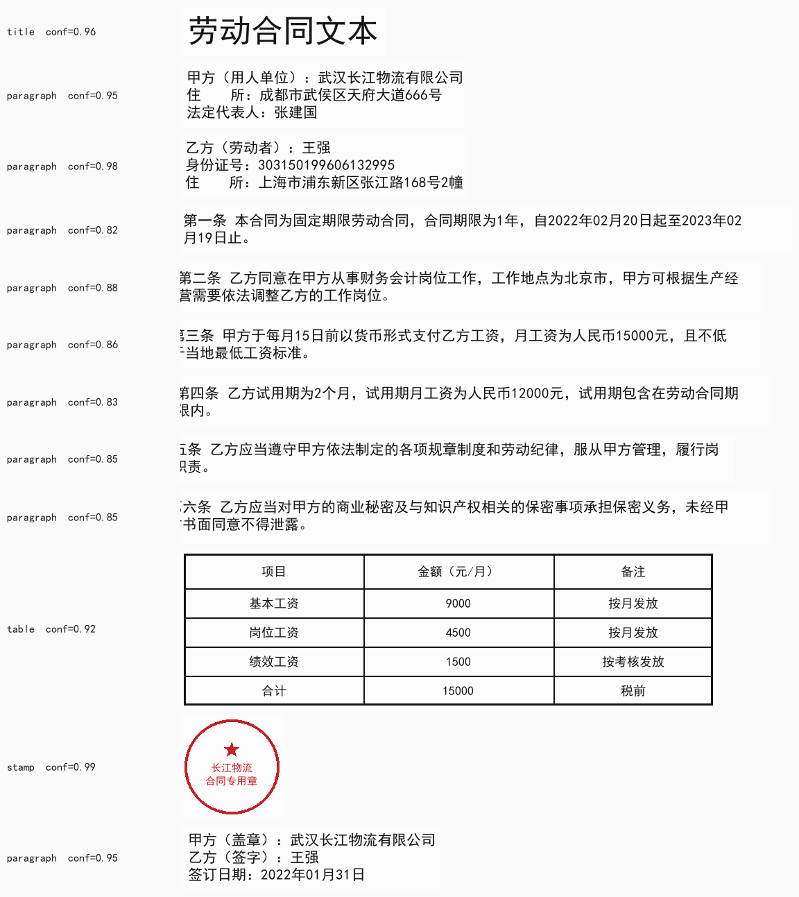

# 法律文书扫描件智能处理：YOLO 版面检测 + PaddleOCR + 规则结构化

> 一句话：**扫描件/拍照的法律文书 → YOLO 检测版面区域（标题/正文/表格/印章）→ 按区域裁剪 → PaddleOCR 识别 → 规则抽取关键字段**，把「视觉 → 文本 → 结构化」整条链路打通，并用可复现的实验说明每个环节的指标与瓶颈。

这是「AI 应用求职作品集」的视觉/多模态项目，和另外两个项目构成一个故事：
**RAG 做知识 → Agent 做行动 → 视觉 demo 做多模态落地**。统一业务场景是**法律文书/劳动合同扫描件的智能录入**（版面区域检测 + 文字识别 + 关键信息抽取）。

---

## 1. 为什么是 YOLO + PaddleOCR

真实的法律文书录入要回答两个问题，正好拆成两层：

| 子问题 | 方案 | 解决什么 |
|---|---|---|
| **哪里是什么**（版面理解） | YOLO11n 目标检测（4 类：`title` / `paragraph` / `table` / `stamp`） | 定位标题、正文段落、表格、红色印章，给下游提供「区域类型 + 位置」先验，并控制阅读顺序 |
| **写的是什么**（文字识别） | PaddleOCR（PP-OCRv5 mobile det + rec，中文） | 中文识别开箱即用、离线可跑；逐区域识别，避免整页缩放损失小字 |
| **它是什么意思**（结构化） | 规则抽取（正则 + 区域类型先验） | 合同期限、月工资、试用期、甲方/乙方、签订日期 → JSON |

为什么不用一个「文档大模型」端到端搞定：

- 面试场景需要**可解释、可拆指标**：检测有 mAP、OCR 有 CER、抽取值准确率，三层可以分别定位问题；
- 检测 + 识别级联**能用少量标注数据训练**（本项目只用 24 张合成训练图）；
- 代价是**误差传导**（检测错 → OCR 错 → 抽取错），本项目用真实数字把这个 trade-off 讲清楚，见 §3、§6。

---

## 2. 架构



**误差传导链**（面试可讲）：检测漏检/框偏移 → 区域裁剪丢字 → OCR CER 升高 → 规则抽不到字段。本项目专门用难例（旋转、印章遮挡）量化了这条链。

---

## 3. 目录结构

```
03-vision-ocr-demo/
├── run_demo.py                  # 一条命令跑完整条流水线（子进程调度两个 Python 环境）
├── scripts/
│   ├── make_dataset.py          # 合成 A4 法律文书图片 + 精确 bbox/全文/字段 GT
│   └── make_report.py           # 汇总 metrics JSON → outputs/report.md
├── src/
│   ├── yolo_detect.py           # YOLO 训练 / 推理 / 官方 model.val() / 手写 IoU 匹配评估 / 测速
│   ├── ocr_paddle.py            # PaddleOCR 整图 vs 区域裁剪，自实现 Levenshtein CER
│   └── extract.py               # OCR 文本 → 劳动合同 JSON 字段 + 字段准确率
├── tests/                       # unittest，`python tests/run_all.py` 直接跑（无 pytest 依赖）
├── data/                        # 合成数据（images / labels / annotations.json / data.yaml）
├── outputs/                     # 真实产物：report.md、metrics_*.json、检测图、裁剪图、抽取 JSON
├── requirements-yolo.txt
├── requirements-ocr.txt
└── .gitignore
```

---

## 4. 快速开始

### 4.1 环境（已就绪，无需 pip install）

两个环境**故意分开**（ultralytics/torch 与 paddlepaddle 依赖容易冲突），由 `run_demo.py` 用 subprocess 分别调度：

```
python   # 需安装：ultralytics 8.4.216 + torch 2.14.1+cpu + opencv + PIL
python   # 需安装：paddlepaddle 3.3.1 + paddleocr 3.7.0
```

没有任何 GPU，全部在 CPU（`12th Gen Intel Core i5-12500H`，16 逻辑核）上运行。

### 4.2 一键运行（推荐）

```powershell
cd 03-vision-ocr-demo

# 完整流程：生成数据 → 训练 YOLO → 评测 → 推理 → OCR → 抽取 → report.md（约 12~16 分钟，纯 CPU）
python run_demo.py

# 已有 models/best.pt，只复现指标 + 报告（约 11 分钟，其中 OCR 占大头）
python run_demo.py --skip-train
```

成功后产出：`outputs/report.md`、`outputs/metrics_yolo.json`、`outputs/metrics_ocr.json`、`outputs/metrics_extract.json`、`outputs/yolo_predictions.json`、`outputs/ocr_texts.json`、`outputs/extracted.json`、`outputs/images/*.png`。

### 4.3 分步运行（想单独跑某一步时）

```powershell
# 1) 合成数据（vision 环境）
python scripts\make_dataset.py --num 32 --num-train 24 --seed 42

# 2) YOLO 训练 + 评测 + 推理（vision 环境；--skip-train 跳过训练）
python src\yolo_detect.py --stage all --epochs 50
python src\yolo_detect.py --stage eval --skip-train

# 3) OCR 对比评测（paddle 环境）
python src\ocr_paddle.py --split val

# 4) 结构化抽取（任意环境，仅标准库）
python src\extract.py --split val

# 5) 生成报告
python scripts\make_report.py
```

### 4.4 测试

```powershell
python tests\run_all.py
```

当前结果：**65 个用例全部通过**（IoU/贪心匹配/AP、Levenshtein/CER、字段抽取、数据集标注自洽性、产物与 README 一致性；不依赖训练好的模型和 paddle）。

---

## 5. 实测指标（全部由本机真实运行产生）

> 环境：**CPU only**（i5-12500H，无 GPU）、Windows、`device=cpu`。
> 数据：**纯合成**，32 张 1000x1414（A4 比例）中文法律文书；train 24 / val 8（含 2 张难例）。
> 所有数字可在 `outputs/metrics_*.json` 中逐项核对；生成命令见 §4。

### 5.1 数据集

| split | 图片数 | title | paragraph | table | stamp | 全文字符数（去换行） |
|---|---|---|---|---|---|---|
| train | 24 | 24 | 191 | 24 | 24 | 10995 |
| val | 8 | 8 | 67 | 8 | 8 | 3808 |

难例 4 张：`low_contrast`（低对比度+噪声，train）、`table_merge`（表格跨行合并，train）、`rotation`（旋转 2.68°，val）、`stamp_occlusion`（印章遮挡正文，val）。训练集 2 张、验证集 2 张。

### 5.2 YOLO 版面检测

训练：`yolo11n.pt` 预训练权重 + 50 epochs、imgsz=640、batch=8、CPU，训练阶段耗时 **313.1 s**（`runs/doc_layout/results.csv`）。评测：留出 val 集 8 张图 / **91 个区域**。

| 指标 | ultralytics `model.val()` | 手写 IoU 匹配（交叉验证） | 差值 |
|---|---|---|---|
| **mAP@0.5** | **0.9944** | **0.9993** | 0.0049 |
| **mAP@0.5:0.95** | **0.8831** | **0.8857** | 0.0026 |
| Precision（官方为最佳 F1 点） | 0.9761 | - | - |
| Recall（官方为最佳 F1 点） | 0.9728 | - | - |
| Precision / Recall（手写，部署 conf=0.25） | - | 0.8426 / 1.0000 | - |

手写评估在同一批 val 预测上与官方几乎一致（差值 < 0.005），说明「IoU 匹配 + TP/FP/FN + AP」的实现是对的；分区域 AP@0.5 为 title 1.0000 / paragraph 0.9971 / table 1.0000 / stamp 1.0000。

**CPU 速度**（`metrics_yolo.json` → `speed`，单张 doc_0024，imgsz=640，15 次取中位数）：

| 统计项 | 数值 |
|---|---|
| 单图端到端耗时（中位数） | **234.39 ms**（P90 369.70 ms） |
| FPS（按中位数） | **4.27** |
| 测量次数 | 15（另有 3 次预热） |

> ⚠️ 该次测速时 CPU 上还有其他任务并发执行，数字明显偏保守；空闲时用同一权重单独复测约为 **50~60 ms/张（约 17~20 FPS）**。`outputs/metrics_yolo.json` 记录的是 run_demo 那次运行的原始测速。

### 5.3 OCR：整图识别 vs 区域裁剪后识别（核心对比）

PaddleOCR：`PP-OCRv5_mobile_det` + `PP-OCRv5_mobile_rec`，lang=ch；**MKLDNN 关闭**（见 §7 的 Paddle 兼容性说明），CPU。评测 val 集 8 张图，第一张图 + 第一个裁剪区域各预热一次，不计入耗时。

| 指标 | 整图直接 OCR | 区域裁剪流水线（YOLO→裁→OCR） |
|---|---|---|
| **CER（总体，按字符加权）** | **0.0450** | **0.0536** |
| CER（逐图平均） | 0.0453 | 0.0533 |
| 整句准确率（行级 exact match） | 0.9934 | 0.8245 |
| 整图完全正确率 | 0.0000 | 0.0000 |
| 平均单图耗时 | 34216 ms | 39925 ms（OCR 部分） |
| 端到端耗时（含 YOLO 检测） | 34216 ms | 40159 ms |
| 平均区域数 / 图 | - | 11.62 |

**按样本类型拆开看（这是最值得讲的结论）：**

| 子集 | 图片数 | 整图 CER | 区域 CER | 整图整句准确率 | 区域整句准确率 |
|---|---|---|---|---|---|
| 正常样本 | 6 | 0.0374 | **0.0173** | 1.0000 | 0.8363 |
| 难例（旋转/印章遮挡） | 2 | 0.0673 | 0.1598 | 0.9737 | 0.7895 |
| 全部 | 8 | 0.0450 | 0.0536 | 0.9934 | 0.8245 |

- **正常扫描件上，分区域识别把 CER 从 0.0374 降到 0.0173（相对下降 ~54%）**：整页 OCR 的检测阶段会把整页缩放，小字细节损失；按区域裁剪后每个区域按自身尺度识别，并且由版面检测控制阅读顺序，所以 CER 更低。这就是「版面检测提升 OCR 质量」的量化证据。
- **但难例上区域流水线反而更差**（0.0673 → 0.1598）：旋转让检测框变成轴对齐大框、混入邻行文字，印章遮挡会让同一段正文被切成两个框、文字重复识别。检测误差直接传导到 OCR，**整体 CER 从 0.0450 变成 0.0536**。
- 结论：级联系统不是「加了检测就一定更好」，**检测质量决定下游上限**；这也是生产上必须做难例回归、检测结果校验/合并的原因。

### 5.4 结构化抽取（OCR 文本 → JSON）

规则方法（正则 + 区域类别），输入是上述「区域裁剪流水线」的 OCR 文本，与数据集自带的字段 GT 对比：

**主要 9 字段整体准确率：0.9167（66/72）**；整图 9 字段全对率 0.3750。

| 字段 | 准确率 | 正确/总数 |
|---|---|---|
| party_a 甲方 | 0.8750 | 7/8 |
| party_b 乙方 | 1.0000 | 8/8 |
| contract_years 合同年限 | 1.0000 | 8/8 |
| contract_start 起始日 | 1.0000 | 8/8 |
| contract_end 结束日 | 0.5000 | 4/8 |
| monthly_salary 月工资 | 1.0000 | 8/8 |
| probation_months 试用期 | 0.8750 | 7/8 |
| job 岗位 | 1.0000 | 8/8 |
| sign_date 签订日期 | 1.0000 | 8/8 |

结束日 4/8 的失败原因很具体：OCR 在长条款折行处吃掉一个数字（如「至2026年0」+「月24日止」丢了月份数字），抽取规则拿不到合法日期就返回空——**错误可以一路追到 OCR**，而不是规则「算错」。这正是把抽取准确率拆开看的意义。

抽取 JSON 示例（`outputs/extracted.json`，图 doc_0024）：

```json
{
  "party_a": "武汉长江物流有限公司",
  "party_b": "王强",
  "contract_years": 1,
  "monthly_salary": 15000,
  "probation_months": 2,
  "probation_salary": 12000,
  "job": "财务会计",
  "sign_date": "2022-01-31",
  "contract_start": "2022-02-20",
  "contract_end": "2023-02-19",
  "stamp_company": "长江物流",
  "document_type": "劳动合同文本"
}
```

### 5.5 速度汇总（CPU）

| 环节 | 实测 |
|---|---|
| YOLO 检测（空闲时复测） | ~50–60 ms/张，约 17–20 FPS |
| YOLO 检测（run_demo 记录，CPU 有其他任务并发） | 234.39 ms/张，4.27 FPS |
| 整图 OCR | 34216 ms/张 |
| 分区域 OCR | 39925 ms/张（+ 检测约 0.23 s） |

瓶颈在 OCR 的逐行识别（约 20~40 行/页，PP-OCRv5 mobile，关闭 MKLDNN 的 CPU 推理）。YOLO 检测只占端到端耗时的 **0.6%** 左右。

---

## 6. 结果示例（真实输出）

**GT（绿框）vs YOLO 预测（红框）**——正常样本，12 个区域全部命中：



**YOLO 检测结果图**（带类别与置信度）：



**区域裁剪示例**（YOLO 检测 → 裁剪 → 逐区域 OCR；可看到印章、表格、落款都按区域切开）：



完整的指标表 + 逐图明细 + 运行耗时见自动生成的 [`outputs/report.md`](outputs/report.md)。

---

## 7. 面试怎么讲（8 条要点）

1. **先把问题拆成「检测 → 识别 → 结构化」三层**，每层有独立指标（mAP / CER / 字段准确率），出问题能定位到层，而不是一个黑盒说「效果还行」。
2. **为什么 YOLO 而不是通用文档解析模型**：4 类版面元素、数据量小（24 张训练图）、CPU 可训练（50 epochs 约 5 分钟），迁移学习足够；通用文档模型在离线 CPU 场景成本高、不可控。
3. **mAP 怎么来**：IoU≥0.5 算 TP，贪心匹配同图同类、置信度从高到低；没匹配上的检测算 FP、没被匹配的 GT 算 FN；按置信度排序列出 PR 曲线用全点插值算 AP，四类平均得 mAP。手写实现与 `model.val()` 在同一批预测上差 0.0049/0.0026，说明指标可信。
4. **分区域 OCR 为什么在正常件上 CER 更低**：整页 OCR 的检测阶段会把 1000x1414 缩到短边 736 左右，21px 正文变成 ~12px；区域裁剪后按区域自身尺度识别，小字不掉细节；版面检测还顺带给出阅读顺序。实测正常样本 CER 0.0374 → 0.0173。
5. **为什么难例上反而更差（最加分的一点）**：级联系统误差传导。旋转 2.68° 后检测框是轴对齐大框，裁剪会混入邻行；印章遮挡让一段正文被切成两个框、文字重复识别。难例 CER 0.0673 → 0.1598，整体被拉高到 0.0536。**检测质量决定 OCR 上限**，生产上要做检测校验/重叠框合并/难例回归。
6. **精确 GT 怎么来**：图片是自己用 PIL 按模板渲染的，bbox/全文/字段都是渲染时直接记录的，没有人工标注噪声，因此指标差异可以完全归因于模型而不是标注。
7. **工程细节**：两个 venv 隔离（torch 与 paddle 依赖冲突），`run_demo.py` 用 subprocess 分别调度；Paddle 3.3.1 + PaddleOCR 3.7 在 CPU 上触发 oneDNN/PIR 兼容性 bug，通过 `paddle.set_flags({"FLAGS_use_mkldnn": False})` + `enable_mkldnn=False` 绕过，代价是推理变慢（这也是 OCR 34s/张的原因）。
8. **耗时拆解与优化优先级**：YOLO ~50ms（0.6%），OCR ~34s（99%+）。优化顺序不是「换更快的检测模型」，而是 OCR：ONNX/OpenVINO 加速、batch 识别、按区域类别只识别必要区域、异步流水线、限制单页文字行数。这个拆解能避免盲目优化。

## 8. 高频追问（4 个 + 1 个加分）

**Q1：IoU 怎么算？匹配时 TP/FP/FN 怎么定？**

IoU = 交集面积 / 并集面积，代码在 `src/yolo_detect.py::iou_xyxy`。评估时按置信度从高到低遍历检测框，每个检测框只在「同类且未被匹配」的 GT 里找 IoU 最大者，IoU ≥ 阈值（0.5）记为 TP 并把该 GT 标记为已匹配；否则 FP；最后没被匹配的 GT 是 FN。一个 GT 只能被匹配一次，所以重复检测是 FP。AP 用全点插值（PR 曲线单调化后按 recall 变化点求和）。

**Q2：mAP 和 mAP@0.5 有什么区别？**

mAP@0.5 只用 IoU≥0.5 一个阈值；mAP@0.5:0.95 在 0.5、0.55、…、0.95 共 10 个阈值上分别算 AP 再平均，要求框更贴合。所以 mAP@0.5:0.95 ≤ mAP@0.5，本 demo 是 0.8831 vs 0.9944。后者更能反映「框得准不准」，前者更关注「找没找到」。

**Q3：小目标 / 遮挡怎么处理？**

数据侧：合成难例（低对比度+噪声、旋转、印章遮挡、表格合并）+ 数据增强；输入侧：提高 imgsz 或对表格/小字区域做切片推理（类似 SAHI）；后处理侧：检测框外扩 padding（本 demo 用 8px）、重叠框合并去重。本 demo 的实测说明：印章遮挡会制造重复检测框，重复区域的 OCR 文本会重复计入，直接拉高 CER——所以遮挡问题不能只靠 OCR 模型抗，必须和检测一起处理。

**Q4：为什么 OCR 用 CER 而不是准确率？**

OCR 是字符级任务，大多数时候只错一两个字。用「整句全对」的准确率会非常苛刻（本 demo 整图完全正确率是 0.0000，但 CER 只有 0.0450）；CER = 编辑距离 / 参考字符数，对局部错误敏感、和文本长度无关，还能 >1（识别结果比原文长很多时）。本 demo 的 CER 是自己实现的 Levenshtein（`src/ocr_paddle.py::levenshtein_distance`），不依赖第三方。

**Q5（加分）：CPU 太慢上线怎么办？**

先拆瓶颈：本 demo 检测占 <1%，OCR 占 99%。落地优先级：① ONNX Runtime / OpenVINO / TensorRT 加速 + INT8 量化；② OCR 批量识别、按区域类别只识别必要区域（印章/表格可以单独策略）；③ 异步流水线 + 队列，把「一页 34s」变成吞吐指标；④ 灰度时对高置信字段直接落库、低置信走人工复核；⑤ 有 GPU 时直接 GPU 推理，或换更小的 OCR 模型。

## 9. 局限与下一步

**局限（必须说清楚）：**

- **合成数据 ≠ 真实扫描件**：真实场景有拍照畸变/阴影/装订线/背景纹理/手写批注/多种印章，指标会明显下降。**本项目指标只用于打通流程、验证指标计算、做架构对比，不代表真实场景性能。**
- CPU 训练轮数有限（50 epochs、24 张训练图），mAP 绝对值不能当作生产水平。
- 难例上检测框偏移/重复检测会把误差传导给 OCR（已量化：难例 CER 0.0673 → 0.1598）。
- 检测框贴边裁剪会切掉少量边缘字符（`outputs/images/region_crops_example.png` 中可见个别行首字被切），这是 8px padding 的取舍；加大 padding 又会引入邻行文字。
- 规则抽取是 baseline，字段格式变化/OCR 严重错字会漏抽（合同结束日 4/8 就是 OCR 吃字导致）。
- Paddle 兼容性 workaround 让 OCR 速度比正常 CPU 推理慢很多。

**下一步：**

1. 引入真实扫描件/拍照数据集（脱敏），做真实场景评测；
2. 数据增强（透视变换、噪声、印章模拟、文字模糊）提升检测鲁棒性；对旋转样本加去斜校正；
3. 检测/OCR 用 ONNX / OpenVINO / TensorRT 加速，OCR 批量化；
4. 重叠检测框合并 + 裁剪 padding 自适应，减少误差传导；
5. 抽取升级：规则 baseline + LLM 兜底/校验，输出字段置信度，低置信走人工复核；
6. 和版面分析模型（如 PP-Structure）做对比实验。

## 10. 产物与复现信息

- 一键产物：`outputs/report.md`（指标表 + 图片链接 + 逐图明细）
- 指标文件：`outputs/metrics_yolo.json`、`outputs/metrics_ocr.json`、`outputs/metrics_extract.json`
- 原始结果：`outputs/yolo_predictions.json`、`outputs/ocr_texts.json`、`outputs/extracted.json`
- 运行元数据：`outputs/run_meta.json`（命令、各步骤耗时、环境）
- 本次 `run_demo.py --skip-train` 实测：总耗时 **656.1 s**（yolo_detect 23.9 s、ocr_paddle 631.8 s、extract 0.1 s、报告 0.2 s），Windows 10 + CPU。
- 训练（单独一步）：`src/yolo_detect.py --stage train --epochs 50`，50 epochs / CPU / 313.1 s。

> 再次强调：以上全部指标来自**合成数据**、**CPU**、**50 epochs** 的小规模实验，用于讲清楚「流程 + 指标 + 误差传导」，不代表真实业务性能。
