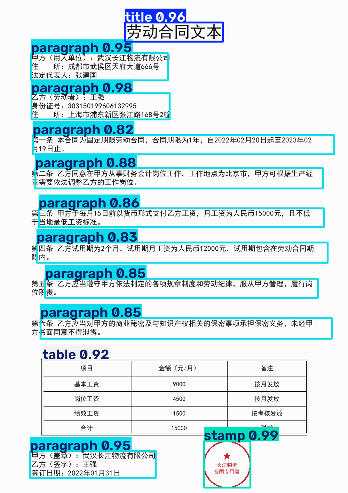
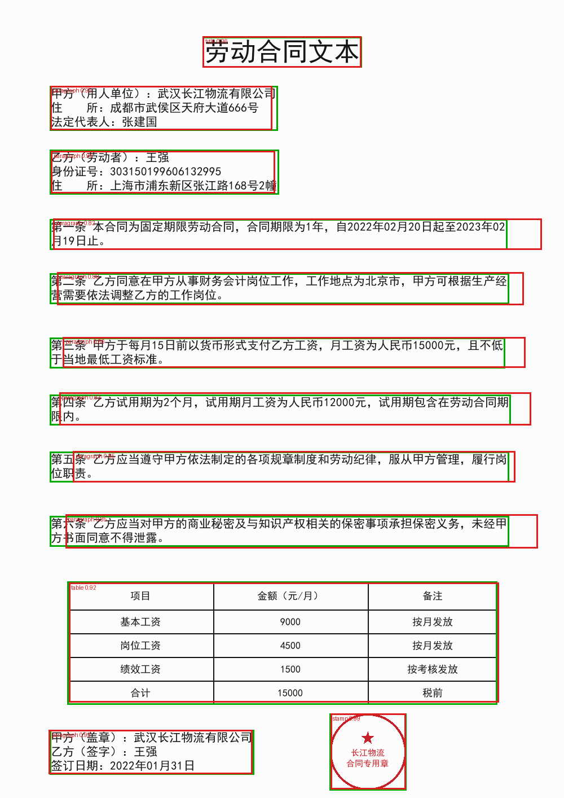
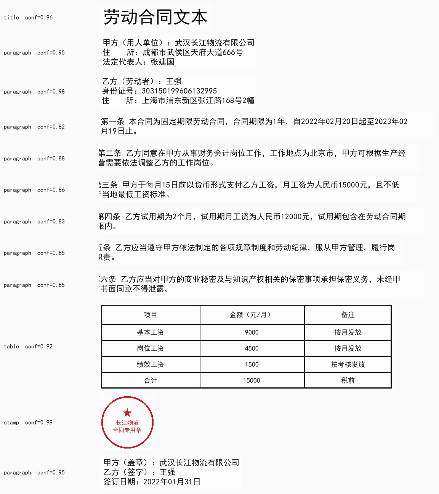

# 法律文书扫描件智能处理 Demo — 运行报告（自动生成）

> 生成时间：2026-11-21 03:43:20　|　数据规模：32 张合成图　|　运行环境：Windows + CPU（无 GPU）
>
> 本报告所有指标均由 `run_demo.py` 实际运行产生，数字对应 `outputs/metrics_*.json`。
> **合成数据只用于打通流程与讲清指标，不代表真实扫描件场景性能。**

## 1. 数据集（合成，带精确标注）

- 生成脚本：`python scripts/make_dataset.py --num 32 --num-train 24 --seed 42`
- 页面尺寸：1000x1414（A4 比例）
- 类别：`title, paragraph, table, stamp`
- 说明：合成数据，bbox 由渲染模板直接给出，是精确 ground truth。

| split | 图片数 | title | paragraph | table | stamp | 全文字符数 |
|---|---|---|---|---|---|---|
| train | 24 | 24 | 191 | 24 | 24 | 10995 |
| val | 8 | 8 | 67 | 8 | 8 | 3808 |

难例（合成）：

| id | split | 难例类型 | 旋转角度 | 区域数 |
|---|---|---|---|---|
| doc_0005 | train | low_contrast | 0.00 | 11 |
| doc_0013 | train | table_merge | 0.00 | 10 |
| doc_0026 | val | rotation | 2.68 | 11 |
| doc_0030 | val | stamp_occlusion | 0.00 | 12 |

## 2. YOLO 版面区域检测（真实指标）

> 训练信息来自 runs/doc_layout 训练产物（本次用 --skip-train 复现指标）

- 训练：基础权重 `yolo11n.pt`（预训练=True），epochs=50，imgsz=640，batch=8，CPU；训练阶段耗时 313.1 s
- 评测集：留出 `val` 集 8 张图 / 91 个区域；推理尺寸 640，部署置信度阈值 0.25
- 环境：12th Gen Intel Core i5-12500H，torch 2.14.1+cpu，ultralytics 8.4.216，device=cpu

| 指标 | ultralytics model.val() | 手写 IoU 匹配（交叉验证） | 差值 |
|---|---|---|---|
| mAP@0.5 | 0.9944 | 0.9993 | 0.0049 |
| mAP@0.5:0.95 | 0.8831 | 0.8857 | 0.0026 |
| Precision（官方为最佳 F1 点） | 0.9761 | - | - |
| Recall（官方为最佳 F1 点） | 0.9728 | - | - |
| Precision（手写，conf=0.25） | - | 0.8426 | - |
| Recall（手写，conf=0.25） | - | 1.0000 | - |

分区域 AP@0.5（手写 IoU 匹配，检测数/TP/FP/FN 统计于 conf=0.001，用于计算 AP）：

| 类别 | GT 数 | 检测数 | TP | FP | FN | AP@0.5 |
|---|---|---|---|---|---|---|
| title | 8 | 575 | 8 | 567 | 0 | 1.0000 |
| paragraph | 67 | 1019 | 67 | 952 | 0 | 0.9971 |
| table | 8 | 468 | 8 | 460 | 0 | 1.0000 |
| stamp | 8 | 338 | 8 | 330 | 0 | 1.0000 |

CPU 速度：

| 统计项 | 数值 |
|---|---|
| 单图端到端耗时（中位数） | 50 ms |
| 单图端到端耗时（均值） | 50 ms |
| P90 | 55 ms |
| FPS（按中位数） | 19.98 |
| 测量次数 | 15 |

> 端到端耗时 = 预处理 + 前向 + NMS/后处理；单进程单张，不含批量优势。

## 3. OCR：整图识别 vs YOLO 区域裁剪后识别（核心对比）

- PaddleOCR：`PP-OCRv5_mobile_det` + `PP-OCRv5_mobile_rec`，lang=ch，mkldnn=False，device=cpu
- 评测集：`val` 集 8 张图；第一张图 + 第一个裁剪区域各跑一次，不计入耗时。

| 指标 | 整图直接 OCR | 区域裁剪流水线（YOLO→裁→OCR） |
|---|---|---|
| CER（总体，按字符加权） | 0.0450 | 0.0536 |
| CER（逐图平均） | 0.0453 | 0.0533 |
| 整句准确率（行级 exact match） | 0.9934 | 0.8245 |
| 整图完全正确率 | 0.0000 | 0.0000 |
| 平均单图耗时 | 34216 ms | 39925 ms（OCR 部分） |
| 端到端耗时（含 YOLO 检测） | 34216 ms | 40159 ms |
| FPS（按端到端） | 0.03 | 0.02 |

对比结论：

- CER 绝对变化 **-0.0086**（整图 CER − 区域 CER，正数代表区域路线更好），相对变化 **-19.1%**；整句准确率变化 **-16.9** 个百分点。
- 区域路线的 OCR 耗时是整图的 **1.17 倍**（不含 YOLO 检测），检测部分来自 YOLO 中位耗时 234 ms。


按样本类型拆开看（说明误差传导）：

| 子集 | 图片数 | 整图 CER | 区域 CER | 整图整句准确率 | 区域整句准确率 |
|---|---|---|---|---|---|
| 正常样本 | 6 | 0.0374 | 0.0173 | 1.0000 | 0.8363 |
| 难例（旋转/遮挡） | 2 | 0.0673 | 0.1598 | 0.9737 | 0.7895 |
| 全部 | 8 | 0.0450 | 0.0536 | 0.9934 | 0.8245 |

> 结论：正常扫描件上「检测→按区域识别」明显降低 CER；但旋转/印章遮挡等难例上，检测框偏移或重复检测会把误差传导进 OCR，反而拉高整体 CER。这正是级联视觉系统（检测 + 识别）最值得在面试里讲的 trade-off。

逐图明细：

| 图片 | 难例 | 整图 CER | 整图耗时 | 区域 CER | 区域耗时 | 区域数 |
|---|---|---|---|---|---|---|
| doc_0024 | - | 0.0360 | 25811 ms | 0.0160 | 46550 ms | 12 |
| doc_0025 | - | 0.0438 | 34669 ms | 0.0219 | 36456 ms | 10 |
| doc_0026 | rotation | 0.1114 | 32600 ms | 0.1965 | 37718 ms | 12 |
| doc_0027 | - | 0.0364 | 36614 ms | 0.0182 | 47281 ms | 12 |
| doc_0028 | - | 0.0389 | 40939 ms | 0.0143 | 40568 ms | 12 |
| doc_0029 | - | 0.0430 | 52212 ms | 0.0090 | 48180 ms | 11 |
| doc_0030 | stamp_occlusion | 0.0264 | 35592 ms | 0.1258 | 46593 ms | 13 |
| doc_0031 | - | 0.0268 | 15286 ms | 0.0246 | 16052 ms | 11 |

## 4. 结构化抽取（OCR 文本 → JSON 字段）

- 方法：正则规则（不依赖 LLM / 第三方 NLP 库）；输入：`outputs\ocr_texts.json`
- 主要 9 字段整体准确率：**0.9167** (66/72)；整图全部字段正确率：0.3750

| 字段 | 准确率 | 正确/总数 | 计入主指标 |
|---|---|---|---|
| party_a | 0.8750 | 7/8 | 是 |
| party_b | 1.0000 | 8/8 | 是 |
| contract_years | 1.0000 | 8/8 | 是 |
| contract_start | 1.0000 | 8/8 | 是 |
| contract_end | 0.5000 | 4/8 | 是 |
| monthly_salary | 1.0000 | 8/8 | 是 |
| probation_months | 0.8750 | 7/8 | 是 |
| job | 1.0000 | 8/8 | 是 |
| sign_date | 1.0000 | 8/8 | 是 |
| probation_salary | 0.8750 | 7/8 |  |
| stamp_company | 0.8750 | 7/8 |  |

抽取 JSON 示例（doc_0024）：

```json
{
  "party_a": "武汉长江物流有限公司",
  "party_b": "王强",
  "contract_years": 1,
  "monthly_salary": 15000,
  "probation_months": 2,
  "probation_salary": 12000,
  "job": "财务会计",
  "sign_date": "2022-01-31",
  "contract_start": "2022-02-20",
  "contract_end": "2023-02-19",
  "stamp_company": "长江物流",
  "document_type": "劳动合同文本"
}
```

## 5. 结果示例

YOLO 检测框（红色为预测框，数字为类别与置信度）：



GT（绿）vs 预测（红）对比：



区域裁剪示例（YOLO 检测框 → 裁剪 → 逐区域 OCR）：



## 6. 复现

```bash
# 完整训练 + 评测（约 10~15 分钟，纯 CPU）
python run_demo.py
# 复用已训练权重，只复现指标与报告（约 10~12 分钟，OCR 占大头）
python run_demo.py --skip-train
```

- 本次运行：2026-11-21 02:29:36 → 2026-11-21 02:40:32，总耗时 656.1 s
- 平台：Windows-10-10.0.26200-SP0，CPU only（无 GPU）
- 命令：`python run_demo.py --skip-train`

| 步骤 | 耗时(s) | 返回码 |
|---|---|---|
| yolo_detect | 23.9 | 0 |
| ocr_paddle | 631.8 | 0 |
| extract | 0.1 | 0 |
| make_report | 0.2 | 0 |

## 7. 局限

- 合成数据 ≠ 真实扫描件：真实场景有拍照畸变、阴影、装订线、背景纹理、手写批注，指标会明显下降。
- CPU 训练轮数有限（YOLO11n + 24 张训练图），mAP 绝对值不能代表生产水平，重点看链路是否打通、指标是否可复算。
- 结构化抽取是规则 baseline，字段格式变化或 OCR 严重错字时会漏抽；生产上还需要 LLM 兜底 + 校验。
- 本机 Paddle 3.3.1 + PaddleOCR 3.7 在 CPU 上存在 oneDNN/PIR 兼容性问题，已关闭 MKLDNN，因此 OCR 速度比正常 CPU 推理慢。
- **真实扫描件验证（见 README §7 / `outputs/real_dataset/report_real.md`）**：真实页整图 OCR CER=0.1280（合成数据为 0.0450），YOLO 在真实表单上 IoU≥0.5 覆盖率仅 0.0248、平均置信度 0.5894 —— 合成数据上的结论不能直接迁移到真实域。
