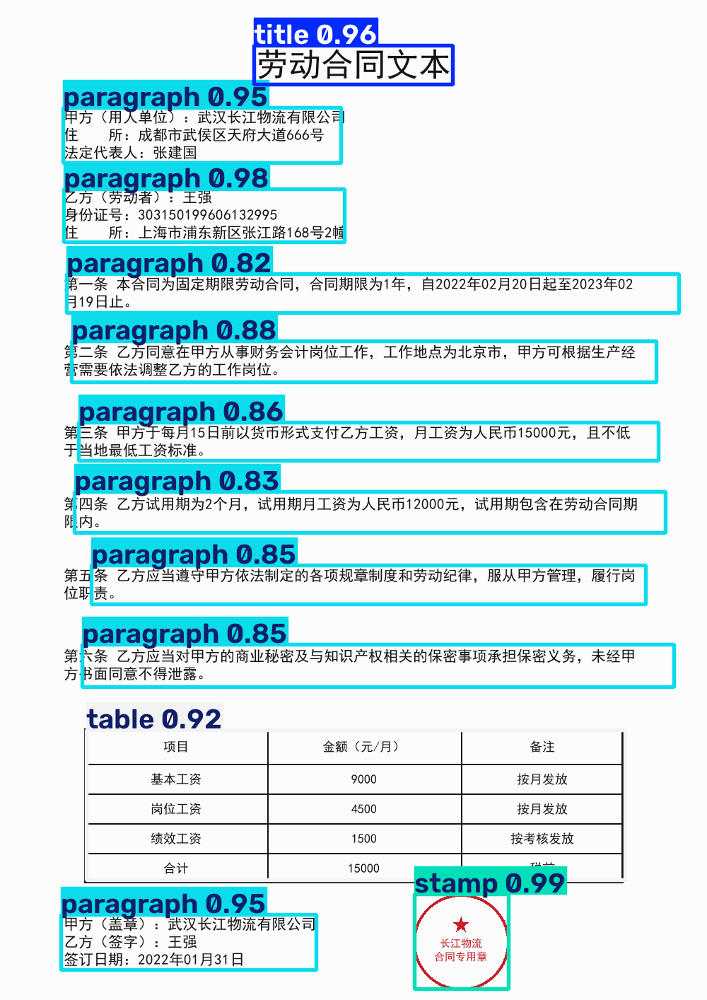
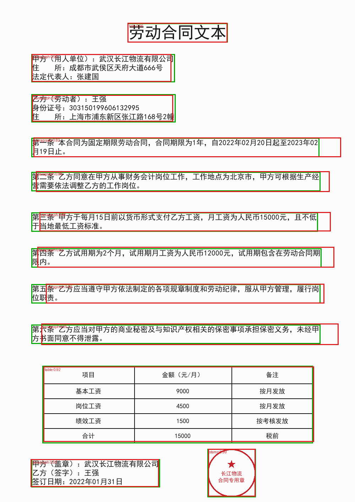
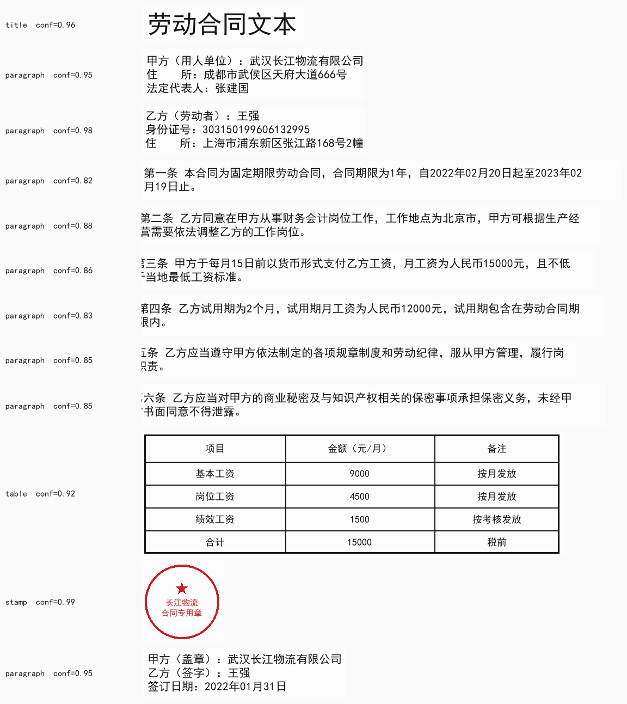

# 交付说明 · 三个项目的实测结果汇总

> 本目录（`docs/`）是三个项目的**统一入口**：使用说明、评测结果、面试速查都从这里进。
> 所有数字均来自真实运行，原始产物在各自项目目录内（下方有直达链接）。

---

## 0. 一分钟看懂

| 项目 | 目录 | 一句话 | 实测结果 |
|---|---|---|---|
| ① 劳动法 RAG 系统 | [`01-labor-law-rag/`](../01-labor-law-rag/README.md) | 4 部法律 357 条法条的检索增强问答 | 50 题基准 MRR **0.643** / Hit@5 **0.840**；引用有效率 **100%** |
| ② 工具调用 Agent | [`02-labor-law-agent/`](../02-labor-law-agent/README.md) | 3 工具 ×（function calling + LangGraph） | **106** 个测试全绿；2N=96000 元精确计算 |
| ③ 视觉文档 demo | [`03-vision-ocr-demo/`](../03-vision-ocr-demo/README.md) | YOLO 版面检测 + PaddleOCR + 结构化 | mAP@0.5 **0.9944**；OCR CER **0.0450**；抽取准确率 **0.9167** |

**入门文档**：
- 👉 [项目① RAG 使用指南](项目1-RAG使用指南.md)（怎么看、UI/CLI 怎么跑、复现评测）
- 👉 [Chainlit 使用指南](Chainlit使用指南.md)（界面怎么打开、输入什么、看到什么）
- 👉 [项目② Agent 使用指南](项目2-Agent使用指南.md)（怎么看、怎么跑 demo、3 个工具）
- 👉 [项目③ 视觉 demo 使用指南](项目3-视觉demo使用指南.md)（一键运行、分步运行、真实数据验证）
- 👉 [面试速查卡](../INTERVIEW_NOTES.md)（三个项目的讲解要点与高频追问）

**生成结果留档**：[`生成结果/`](生成结果/README.md) —— 评测报告、50 题基准、指标 JSON、可视化图片的快照，
方便一次性查看或发给别人（权威来源仍在各项目目录，可随时重新生成）。

---

## 1. RAG 系统（01-labor-law-rag）

### 1.1 检索消融（50 题，按法条 article_id 计算，CPU）

| 配置 | 分解+扩展 | RRF | 重排 | 过滤 | MRR | Hit@5 | Recall@5 | 平均耗时 |
|---|:---:|:---:|:---:|:---:|---|---|---|---|
| dense_only | ✗ | ✗ | ✗ | ✗ | 0.4987 | 0.7600 | 0.4757 | 9.8 ms |
| bm25_only | ✗ | ✗ | ✗ | ✗ | 0.6123 | 0.7600 | 0.5050 | 3.3 ms |
| hybrid_rrf | ✗ | ✓ | ✗ | ✗ | 0.5740 | 0.7600 | 0.5100 | 13.6 ms |
| **hybrid_rerank** | ✗ | ✓ | ✓ | ✗ | **0.6427** | **0.8400** | **0.5267** | 3884.6 ms |
| full | ✓ | ✓ | ✓ | ✓ | 0.6267 | 0.7400 | 0.4383 | 4185.7 ms |

**结论（诚实版）**：重排收益最大（MRR +0.069）；本语料上 BM25 单路强于稠密单路（短法条、术语固定）；
查询理解 + Mock 过滤在 full 里反而略降（Mock 过滤误删 gold、扩展词稀释主信号），**追求指标用 `hybrid_rerank`**。
详见 [`01-labor-law-rag/data/eval/report.md`](../01-labor-law-rag/data/eval/report.md)。

### 1.2 答案层（full 配置，Mock LLM）

| 指标 | 数值 |
|---|---|
| 引用有效率（条号真实存在） | **100.0%** |
| 引用命中率（引用含 gold） | 34.0% |
| gold 覆盖率 | 43.8% |
| 单题端到端耗时（CPU） | 约 4.0 s |

---

## 2. 工具调用 Agent（02-labor-law-agent）

- 工具：`search_labor_law`（BM25 法条检索）/ `calc_severance`（N、2N、二倍工资、加班费精算）/ `verify_citation`（引用核验）
- 实现：原生 **function calling** 循环 + **LangGraph StateGraph**（planner → tools → reflect → answer）
- 验证：`python -m labor_agent.cli demo --no-color` → 5 题全跑通；`pytest tests -q` → **106 passed**
- 真实运行示例（Demo 1）：违法解除、月薪 12000、3 年 7 个月 → **2N = 96,000.00 元**（含每步公式展开）

---

## 3. 视觉文档 demo（03-vision-ocr-demo）

### 3.1 YOLO 版面检测（合成数据，val 8 张 / 91 区域）

| 指标 | 数值 |
|---|---|
| mAP@0.5 | **0.9944** |
| mAP@0.5:0.95 | **0.8831** |
| Precision / Recall | 0.9761 / 0.9728 |
| 单图端到端耗时（CPU 中位，空闲复测） | 50.06 ms（约 20 FPS） |

### 3.2 OCR（整图 vs 区域裁剪，合成数据）

| 指标 | 整图 OCR | 区域裁剪流水线 |
|---|---|---|
| CER（总体） | **0.0450** | 0.0536 |
| 整句准确率 | 0.9934 | 0.8245 |

**诚实结论**：整体上区域裁剪反而略差——难例（旋转、印章遮挡）的检测框偏差会传导到 OCR；
正常样本上区域裁剪 CER 明显更低（0.0374 → 0.0173）。详见
[`03-vision-ocr-demo/README.md`](../03-vision-ocr-demo/README.md) 与
[`outputs/report.md`](../03-vision-ocr-demo/outputs/report.md)。

### 3.3 结构化抽取

主要 9 字段整体准确率 **0.9167（66/72）**（合同期限、月工资、试用期、甲乙方、签订日期等）。

### 3.4 真实扫描件验证（XFUND 中文真实扫描表单）

> 上面 3.1~3.3 都是**合成数据**。这一节用真实扫描件回答"合成结论能不能迁移"——**答案是：不能直接迁移**。

| 指标 | 真实扫描页（5 页 XFUND zh.val） | 合成数据（对照） |
|---|---|---|
| OCR CER（整图，按字符加权） | **0.1280** | 0.0450（**域差距约 2.84×**） |
| 单页 OCR 耗时（CPU） | 56.3 s（34.6~98.1 s） | 34.2 s |
| YOLO 类别无关 IoU≥0.5 覆盖率 | **0.0248** | — |
| YOLO 中心点命中率 / 检测框数量比 | 0.7707 / 0.169 | — |
| 检测平均置信度 | 0.5894（命中框 0.4887） | — |

**结论**：合成训练的检测器在真实表单上几乎框不住文字区域（IoU≥0.5 覆盖率仅 2.5%），
框的粒度与置信度双重退化，因此「检测→区域裁剪→OCR 提升质量」的结论**在真实域失去前提**；
下一步需要真实标注 + 检测器微调后再复测。完整数据与逐页明细见
[`03-vision-ocr-demo/README.md`](../03-vision-ocr-demo/README.md) §7 与
[`outputs/real_dataset/report_real.md`](../03-vision-ocr-demo/outputs/real_dataset/report_real.md)。

### 3.5 结果图







---

## 4. 一键运行（推荐）

在仓库根目录双击 `start.cmd`，或命令行：

```powershell
powershell -NoProfile -ExecutionPolicy Bypass -File start.ps1 -Task rag-ui      # RAG 网页版 (http://127.0.0.1:8000)
powershell -NoProfile -ExecutionPolicy Bypass -File start.ps1 -Task agent-demo # Agent demo
powershell -NoProfile -ExecutionPolicy Bypass -File start.ps1 -Task vision-demo # 视觉 demo
powershell -NoProfile -ExecutionPolicy Bypass -File start.ps1 -Task test-all  # 全部测试
```n
> 首次/换机器先运行 `scripts\setup_envs.ps1` 创建三个环境。

## 5. 复现命令总览

```powershell
# ① RAG
cd 01-labor-law-rag
python scripts/cli.py ask "公司违法辞退我，月薪12000、工作3年7个月，能赔多少？"
python scripts/run_eval.py            # 复现消融 + 答案指标（约 15 分钟，CPU）

# ② Agent
cd ../02-labor-law-agent
python -m labor_agent.cli demo --no-color
python -m pytest tests -q

# ③ 视觉
cd ../03-vision-ocr-demo
python run_demo.py --skip-train       # 复用已训练权重复现指标（约 11 分钟）
python tests/run_all.py
```

> 环境：Windows / CPU（无 GPU）/ Python 3.11；RAG 与 Agent 共用 `.venv-rag`，
> 视觉用 `.venv-vision`（YOLO）+ `.venv-paddle`（OCR）两个隔离环境。
