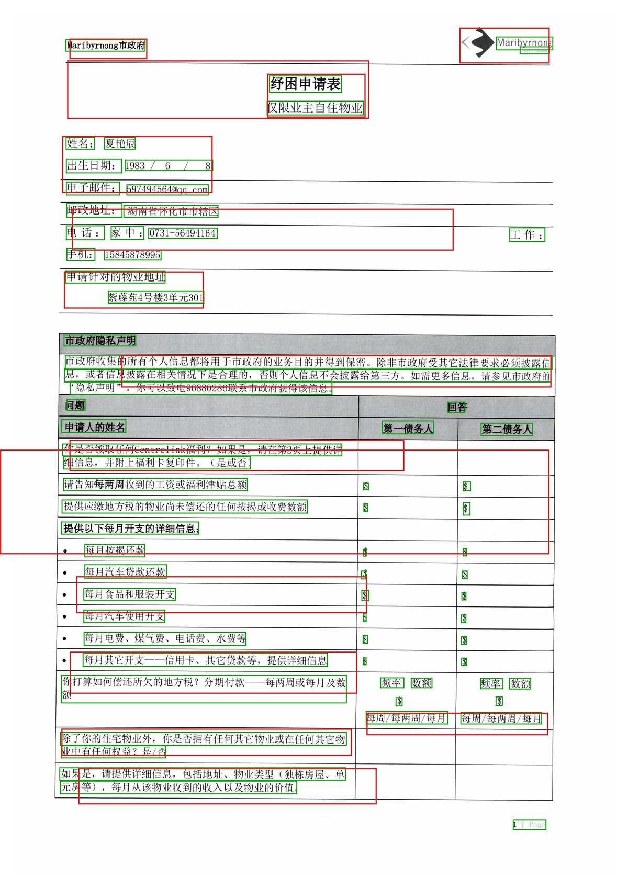
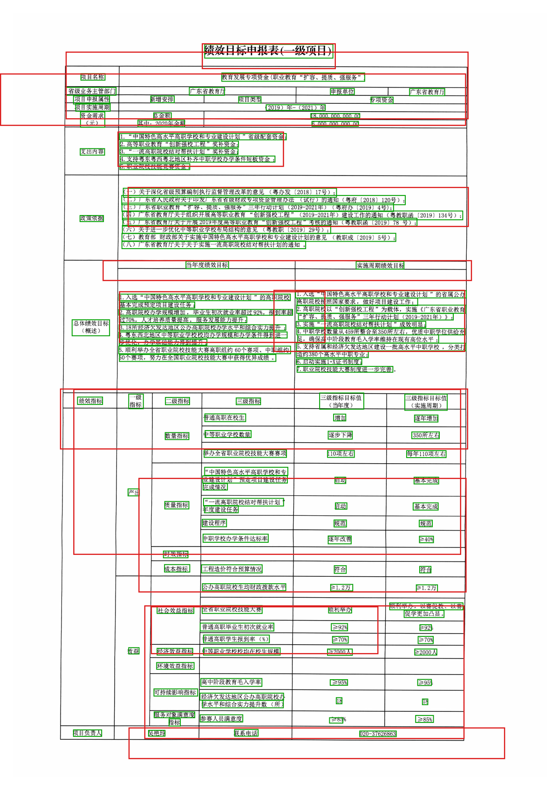
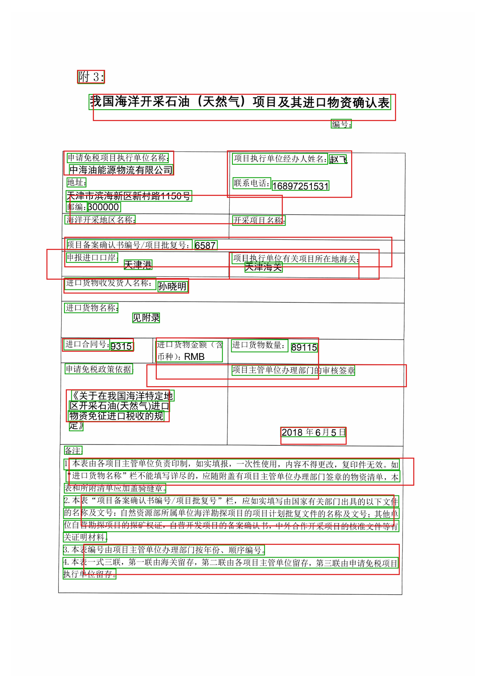

> 📌 本文件是 `03-vision-ocr-demo/outputs/real_dataset/report_real.md` 的交付快照（图片已复制到 `images/`）。

# 真实扫描件验证报告（XFUND zh.val）

> 生成时间：2026-11-21 03:19:20　|　数据：XFUND v1.0 zh.val（真实扫描中文表单）　|　评测 5 页　|　环境：Windows + CPU
> 样本量：仅 5 页（真实页整图 OCR 约 30~90s/页，样本量有限，指标为方向性结论，不能当统计显著性）。
>
> 数据来源：https://github.com/doc-analysis/XFUND/releases/tag/v1.0
> **这是真实扫描件（非合成数据）**；所有数字来自实际运行。

## 1. OCR：真实页整图识别 CER

- 模型：PP-OCRv5_mobile_det + PP-OCRv5_mobile_rec（MKLDNN=False，CPU）
- 机制：整图直接 OCR（不裁剪）；用第一页左上角小裁剪图预热一次，不计入逐页耗时。

| 指标 | 真实扫描页 | 合成数据（对照） |
|---|---|---|
| CER（加权） | **0.1280** | 0.0450 |
| CER 均值 | 0.1425 | - |
| 平均单页 OCR 耗时 | 56344 ms | 34216 ms |
| 评测页数 | 5 | 8（val 集） |

逐页明细：

| 页面 | GT 字数 | OCR 字数 | 编辑距离 | CER | 耗时 |
|---|---|---|---|---|---|
| zh_val_0 | 662 | 649 | 52 | 0.0785 | 53523 ms |
| zh_val_1 | 1640 | 1641 | 192 | 0.1171 | 98135 ms |
| zh_val_2 | 610 | 610 | 78 | 0.1279 | 47318 ms |
| zh_val_3 | 450 | 432 | 95 | 0.2111 | 48136 ms |
| zh_val_4 | 264 | 256 | 47 | 0.1780 | 34605 ms |

共 5 页、3626 个 GT 字符，总 OCR 耗时 281.7 s。

## 2. YOLO 域差距（类别无关，不报 mAP）

- 模型：models/best.pt（训练数据：合成法律文书（title/paragraph/table/stamp））
- 推理：imgsz=640，conf=0.25，device=cpu
- 说明：类别无关评估：XFUND 标签为 header/question/answer/other，与合成数据 4 类不可直接映射，因此不报 mAP。

| 指标 | 数值 |
|---|---|
| GT 文本框数 | 362 |
| 检测框数 | 61 |
| 检测框/GT框 数量比 | 0.17 |
| IoU≥0.5 覆盖率（类别无关 recall） | **0.0248** |
| 中心点命中率（至少 1 个检测框覆盖 GT 中心，0~1） | 0.7707 |
| 中心点平均命中个数（每 GT 落在几个检测框内，可 >1） | 0.9613 |
| GT 面积平均被覆盖比例 | 0.7543 |
| 检测框平均置信度 | 0.5894 |
| 命中检测框平均置信度（IoU≥0.5） | 0.4887 |
| 检测类别分布 | {"title": 8, "paragraph": 43, "table": 10, "stamp": 0} |

逐页明细：

| 页面 | GT 数 | 检测数 | 数量比 | recall_iou50 | 中心命中率 | 面积覆盖 | 平均置信度 |
|---|---|---|---|---|---|---|---|
| zh_val_0 | 71 | 15 | 0.21 | 0.0141 | 0.5915 | 0.5591 | 0.5579 |
| zh_val_1 | 131 | 14 | 0.11 | 0.0076 | 0.9008 | 0.8901 | 0.5435 |
| zh_val_2 | 48 | 17 | 0.35 | 0.1042 | 0.8125 | 0.7714 | 0.5970 |
| zh_val_3 | 67 | 9 | 0.13 | 0.0149 | 0.5672 | 0.5797 | 0.5412 |
| zh_val_4 | 45 | 6 | 0.13 | 0.0222 | 0.9333 | 0.9090 | 0.7075 |

## 3. 结构化抽取

**不适用**：XFUND 是真实表单（header/question/answer 语义的问答对），不是劳动合同模板；现有规则抽取器（合同期限/工资/试用期等字段）无法直接套用，硬套会得到没有意义的数字。如需迁移，需要重新定义字段 schema 并标注少量真实样本后训练/写规则。

## 4. 结论与局限

- XFUND GT 是实体级标注，不是逐字全文转录；页面装饰文字（如页码）可能未被标注，整图 OCR 读到的这类文字会作为插入错误计入 CER，因此真实 CER 略偏高。
- YOLO 用合成数据训练、真实数据推理，本质上是一次 OOD（out-of-distribution）测试；XFUND 的 GT 是行/词级实体框，而合成模型学的是版面块级框，粒度不匹配是 recall_iou50 极低的主因。
- 本评测不报告 mAP：类别语义不可映射。
- **域差距**：真实扫描件整图 OCR CER = 0.1280，合成数据为 0.0450，约 2.84 倍；说明合成数据上的绝对值不能直接外推。
- **结论是否迁移**：合成数据上「检测→区域裁剪→OCR 提升质量」的结论在真实域**无法直接复现**：合成训练的检测器在真实表单上 IoU≥0.5 的文本区域覆盖率仅 0.0248，裁剪区域会错位，瓶颈在检测器的域泛化能力，而不是 OCR 模型本身。
- 真实 CER 偏高的原因：真实扫描噪声/倾斜/中英混排、GT 是实体级标注（页码等装饰文字未标注），以及 OCR 对真实表单密集小字/表格线的识别难度。

## 5. 样例图（GT 绿框 / YOLO 预测红框）

