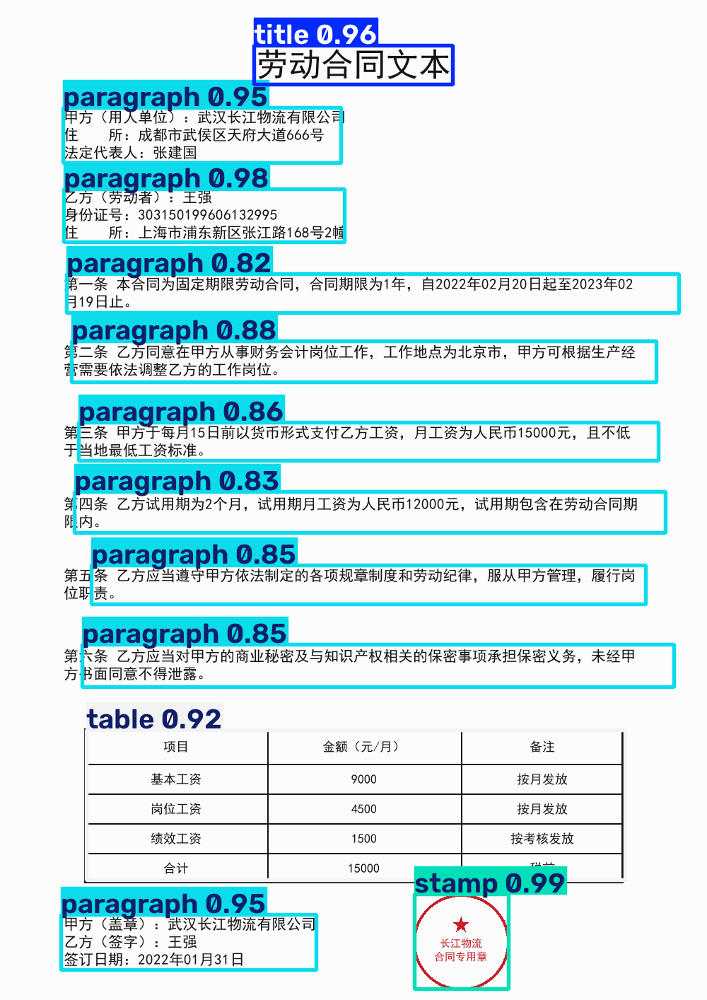
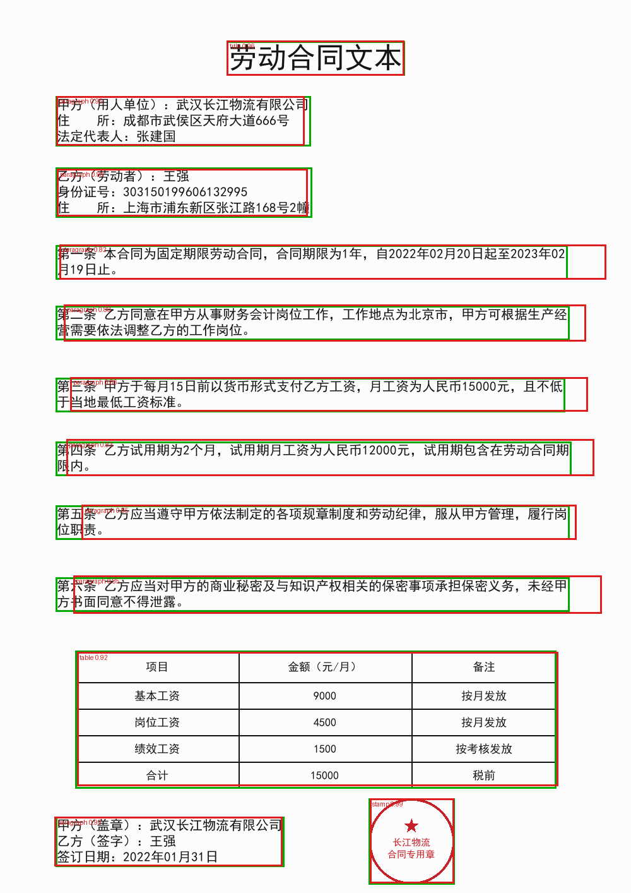

> **最快运行**：仓库根目录双击 `start.cmd` → 选 `6) 视觉 demo`；或 `powershell -File start.ps1 -Task vision-demo`。
> 本机三个环境已就绪（`.venv-vision` / `.venv-paddle`）；换机器先运行 `scripts\setup_envs.ps1`。

# 项目③ 视觉文档 demo · 怎么看 / 怎么运行

> 目录：[`03-vision-ocr-demo/`](../03-vision-ocr-demo/README.md)
> 一句话：**法律文书扫描件 → YOLO 版面检测（标题/正文/表格/印章）→ 区域裁剪 → PaddleOCR 识别 → 规则抽取字段**，
> 把「视觉 → 文本 → 结构化」整条链路跑通，并给出真实指标与真实数据验证。

---

## 1. 先看什么（不想跑代码，3 分钟看懂）

| 顺序 | 打开什么 | 能看到什么 |
|---|---|---|
| 1 | [`outputs/report.md`](../03-vision-ocr-demo/outputs/report.md) | 自动生成的全链路报告：数据集、YOLO 指标、OCR 对比、抽取准确率 |
| 2 | [`outputs/images/`](../03-vision-ocr-demo/outputs/images/) | 检测框可视化、GT vs 预测对比、区域裁剪示例 |
| 3 | [`README.md`](../03-vision-ocr-demo/README.md) §5 | 完整指标表 + 指标解释 |
| 4 | [`README.md`](../03-vision-ocr-demo/README.md) §7 | **真实扫描件验证**（XFUND 中文）：真实 CER 0.128 vs 合成 0.045 |
| 5 | `outputs/metrics_*.json` | 所有指标的原始数值（可逐项核对） |

检测结果示例（`outputs/images/det_doc_0024.png`）：



GT（绿）vs 预测（红）：



---

## 2. 怎么运行

### 2.1 环境（这个项目需要两个隔离环境）

```text
D:\Vibe Coding Projects\labor-law-ai-portfolio\.venv-vision\Scripts\python.exe   # ultralytics + torch（YOLO/训练/测速）
D:\Vibe Coding Projects\labor-law-ai-portfolio\.venv-paddle\Scripts\python.exe   # paddlepaddle + paddleocr（OCR）
```

> 为什么分开：ultralytics/torch 与 paddle 的依赖容易冲突。`run_demo.py` 会自动找到兄弟目录里的
> `.venv-paddle`；找不到时用 `--paddle-python <路径>` 指定。

从零搭环境（换机器时）：

```powershell
cd 03-vision-ocr-demo
python -m venv ..\.venv-vision
& ..\.venv-vision\Scripts\python.exe -m pip install -r requirements-yolo.txt

python -m venv ..\.venv-paddle
& ..\.venv-paddle\Scripts\python.exe -m pip install -r requirements-ocr.txt
```

### 2.2 一键运行（推荐）

```powershell
cd "D:\Vibe Coding Projects\labor-law-ai-portfolio\03-vision-ocr-demo"

# 复用已训练好的 models/best.pt，只复现指标 + 报告（约 11 分钟，OCR 占大头）
& "D:\Vibe Coding Projects\labor-law-ai-portfolio\.venv-vision\Scripts\python.exe" run_demo.py --skip-train

# 从零训练 + 全流程（约 15 分钟，CPU）
& "D:\Vibe Coding Projects\labor-law-ai-portfolio\.venv-vision\Scripts\python.exe" run_demo.py
```

运行完看 `outputs/report.md`。

### 2.3 只想快速跑一部分（分步命令）

```powershell
$vision = "D:\Vibe Coding Projects\labor-law-ai-portfolio\.venv-vision\Scripts\python.exe"
$paddle = "D:\Vibe Coding Projects\labor-law-ai-portfolio\.venv-paddle\Scripts\python.exe"

# ① YOLO 评估（约 1 分钟，含 mAP + 手写 IoU 验证 + 测速）
& $vision src\yolo_detect.py --stage eval --skip-train

# ② OCR 对比评测（约 6 分钟：8 页 × 整图 + 区域两轮）
& $paddle src\ocr_paddle.py --split val

# ③ 结构化抽取（秒级）
& $vision src\extract.py --split val

# ④ 重新生成报告（秒级，把上面三步的结果汇总成 report.md）
& $vision scripts\make_report.py --data-dir data --out outputs

# ⑤ 测试（74 个用例，秒级）
& $vision tests\run_all.py
```

### 2.4 真实扫描件验证（可选，需下载约 66MB）

```powershell
cd "D:\Vibe Coding Projects\labor-law-ai-portfolio\03-vision-ocr-demo"
& "D:\Vibe Coding Projects\labor-law-ai-portfolio\.venv-vision\Scripts\python.exe" scripts\eval_real_dataset.py --stage all --max-pages 5
```

- 自动从 GitHub 下载 **XFUND v1.0 中文 zh.val**（真实扫描表单），约 6 分钟（OCR 慢）；
- 产出 `outputs/real_dataset/report_real.md` 与标注对比图；
- 结论（诚实）：真实 CER 0.1280 vs 合成 0.0450；合成训练的 YOLO 在真实表单上 IoU≥0.5 覆盖率仅 2.48%
  —— **合成数据结论不能直接迁移到真实域**。

---

## 3. 会看到什么

`outputs/report.md` 会自动生成这些表（以下是当前实测值）：

| 环节 | 指标 | 数值 |
|---|---|---|
| YOLO | mAP@0.5 / mAP@0.5:0.95 | **0.9944 / 0.8831** |
| YOLO | 单图耗时（CPU 空闲） | **50.06 ms（约 20 FPS）** |
| OCR | 整图 CER / 区域裁剪 CER | **0.0450 / 0.0536** |
| 抽取 | 9 字段准确率 | **0.9167（66/72）** |
| 真实数据 | XFUND 真实页 CER | **0.1280（域差距 2.84×）** |

> 注意：以上是**合成数据**指标（除最后一行），用于打通流程与验证指标计算，不代表真实场景性能。
> 真实数据结论见 README §7。

---

## 4. 常见问题

| 现象 | 原因 / 解决 |
|---|---|
| OCR 很慢（30~100 秒/页） | CPU + Paddle 3.3 的 oneDNN/PIR 兼容问题，已强制 `MKLDNN=False`；想快需要 GPU 或换 Paddle 版本 |
| `找不到 .venv-paddle 的 python.exe` | 用 `--paddle-python "路径\python.exe"` 指定，或把 `.venv-paddle` 放到项目兄弟目录 |
| `data/data.yaml` 为空 | 运行 `python scripts/make_dataset.py --num 32 --num-train 24` 重新生成 |
| 想跳过训练 | 加 `--skip-train`（需要 `models/best.pt` 已存在） |
| 报告里数字和 README 不一致 | 报告来自 `outputs/metrics_*.json`；重跑某个阶段后用 `make_report.py` 重新汇总 |
| 中文乱码 | 脚本已内置 `sys.stdout.reconfigure(encoding="utf-8")`；终端仍乱码时设 `$env:PYTHONIOENCODING="utf-8"` |

---

## 5. 文件地图

```
03-vision-ocr-demo/
├── run_demo.py                 # 一键运行（调度两个 Python 环境）
├── scripts/
│   ├── make_dataset.py         # 合成 A4 法律文书 + 精确 bbox/全文 GT
│   ├── make_report.py          # metrics JSON → outputs/report.md
│   └── eval_real_dataset.py    # 真实扫描件（XFUND 中文）验证
├── src/
│   ├── yolo_detect.py          # 训练 / 评估 / 推理 / 测速
│   ├── ocr_paddle.py           # 整图 vs 区域裁剪 OCR 对比
│   └── extract.py              # OCR 文本 → 结构化 JSON
├── tests/run_all.py            # 74 个 unittest 用例
├── data/                       # 合成数据（train/val 图片 + labels + annotations.json）
├── models/best.pt              # 已训练好的 YOLO 权重（--skip-train 直接复用）
└── outputs/
    ├── report.md               # ★ 全链路报告
    ├── metrics_*.json          # 原始指标
    ├── images/                 # 检测框 / GT对比 / 区域裁剪
    └── real_dataset/           # 真实扫描件验证报告与样例图
```
